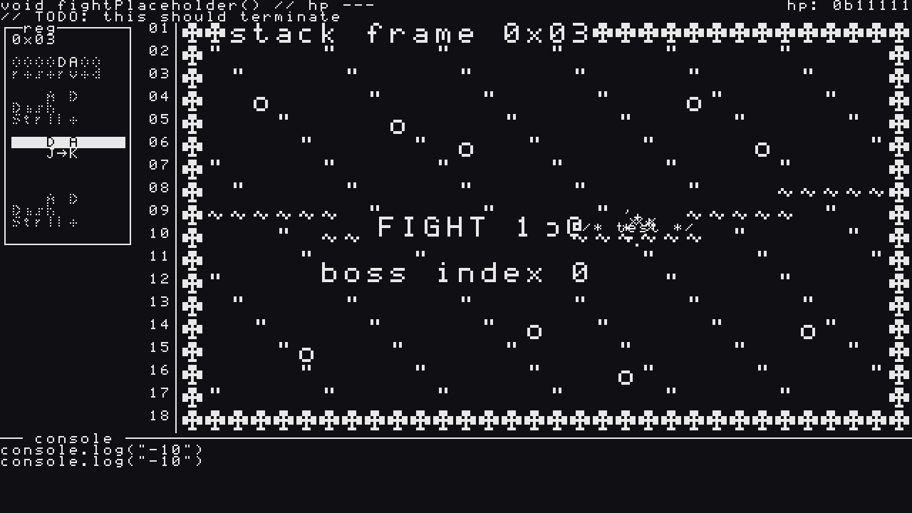
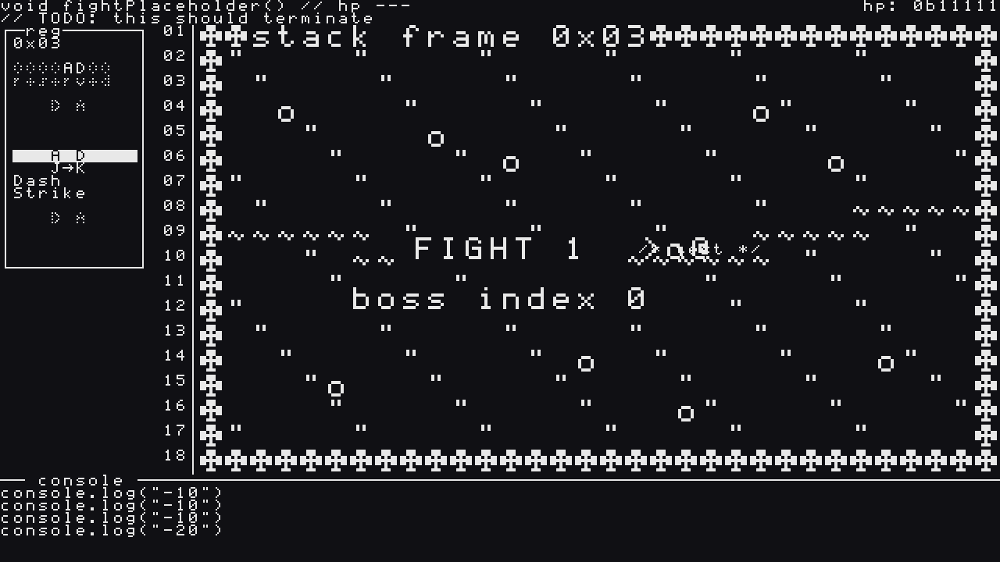
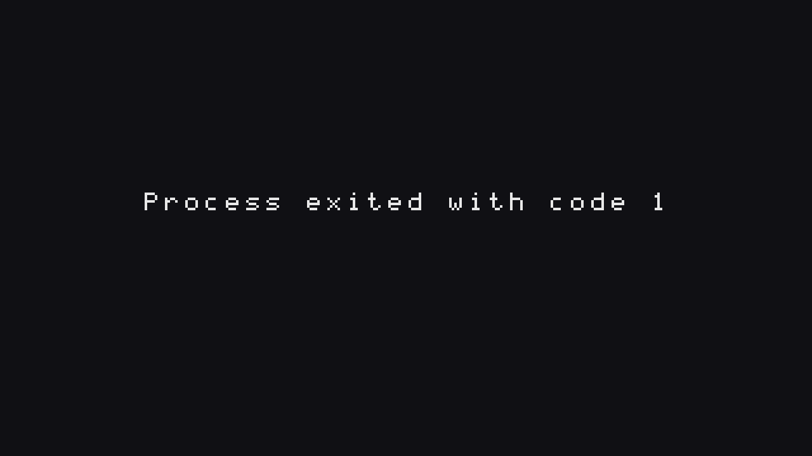

It's November again, which means GitHub Game Off. Last year I built [Grav-Sync](https://bstz.it/p/adding-interactive-cockpit-controls-to-grav-sync/) in plain JavaScript; this year the theme is **SHIFT** and my entry is **The Debugger 0x03: Wild Shift**, a top-down boss rush made with Godot 4.7. You can follow it on [itch.io](https://basteez.itch.io/wild-shift), and this post is a mirror of the [first devlog I published there](https://basteez.itch.io/wild-shift/devlog/1767483/devlog-1-your-weapon-is-a-byte-building-the-register).

**The idea in one line:** your weapon is a bit register. Shift it left or right mid-fight, and the two leftmost bits become your two action buttons. A present-day developer and their rubber duck get pulled into a fantasy RPG where the monsters are literal software bugs: Infinite Loop, Null Pointer and Segfault.

## Day 1: making it run in the browser (Epic 1)

Before writing any gameplay, I wanted the boring stuff to work: a Godot 4.7 project that runs at a locked 60 Hz with pixel-perfect integer scaling, a web export that stays under 30 MB, and a CI pipeline that runs the tests on every pull request.

Then the shell of the game:

- a **title screen with "press to start"**, because browsers won't play audio before your first input
- **The Clearing**, the arena, framed by an IDE-style HUD: register panel on the left, log panel at the bottom, line numbers down the edge
- the whole scene flow with placeholders (Title → Intro → Fight → Harvest → … → Ending)
- **auto-pause** when you switch tabs, so the boss doesn't kill you while you read Slack

## Days 2–3: the shift has to feel good (Epic 2)

The goal of Epic 2 was simple to say and hard to do: *shifting should feel great in an empty arena, before there's anything to fight.*

- **The register is a ring.** `Q` rotates it `<<`, `E` rotates it `>>`. It only contains the bits you own, so you can never end up in a dead state. The HUD also shows its byte value, so your build is literally `0x03`.
- **Shift juice:** the register slides with a small overshoot bounce, a mechanical key-click (two different sounds for left and right), and your weapon inverts for 4 frames.
- **ATTACK and DASH:** a 3-hit slash chain and an 8-frame invulnerable dash.
- **Ordered combos:** the order matters. `[A, D]` (attack then dash) is **Dash Strike**, `[D, A]` is just a dash followed by a slash.
- **Hit feedback:** hit-stop, glyph particles flying off the target, and every hit printed as a `console.log` line.

*The 3-hit slash chain on the practice target: glyph particles and damage logged to the console.*

*After one `<<` the active window is `[A, D]`: J→K fires a Dash Strike.*

- **Death and retry:** you have 5 HP, shown as `0b11111`. When you die you get `Process exited with code 1`, and one key puts you back at the start of the fight in under 2 seconds.
- **A practice target:** `/* test */`, with infinite HP and a frame counter, so I can check the combo numbers on screen.

Under the hood the whole simulation is deterministic: it runs on a fixed 60 Hz clock, with seeded randomness and recorded input replays. That means a bug I find while playing can be replayed exactly in a test.

*(The "FIGHT 1 / boss index 0" text in the screenshots is a placeholder: the arena is still waiting for its first boss.)*

## How it's made

I'm making this solo, as director and playtester. The code is written by AI agents (Claude), following specs I write and approve with the [BMAD Method](https://github.com/bmad-code-org/BMAD-METHOD), the same workflow I described in [BMAD, end to end](https://bstz.it/p/a-bmad-workflow-end-to-end-shipping-a-feature-the-spec-driven-way/): game brief → GDD → architecture → one spec per story. Every story is a pull request with code review and automated tests (55 test files by the end of Epic 2). All the design docs are public in the [GitHub repo](https://github.com/basteez/the-debugger-0x3-wild-shift).

## Next up

The first real bug: **Infinite Loop**, a snake made of code that repeats its attacks… until you find its weak window. Plus the rubber duck, who finally gets a voice, powered by [mumble-speech](https://github.com/basteez/mumble-speech), my own library: v0.3.0 added Godot web support, so the duck can talk in the browser too.

Thanks for reading!
