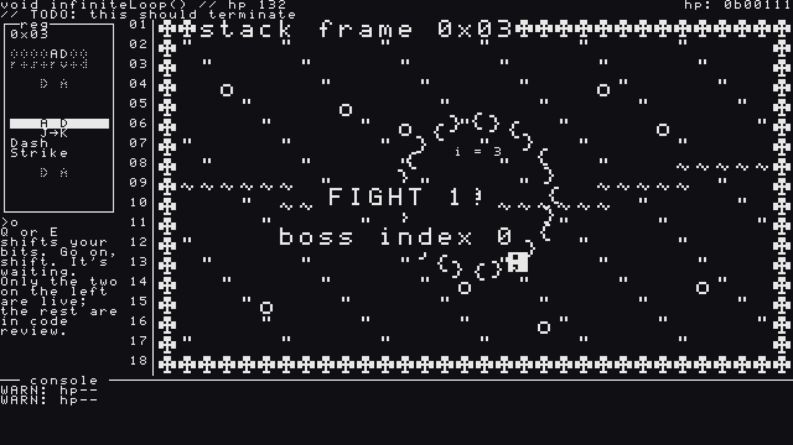
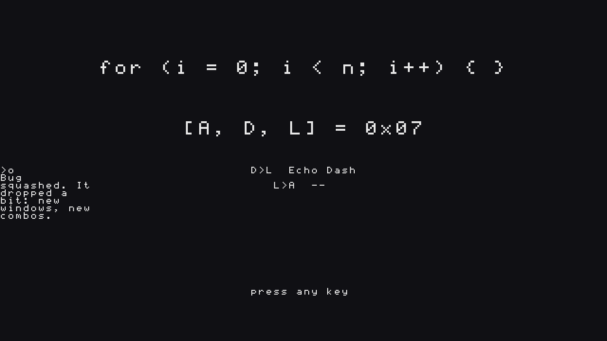
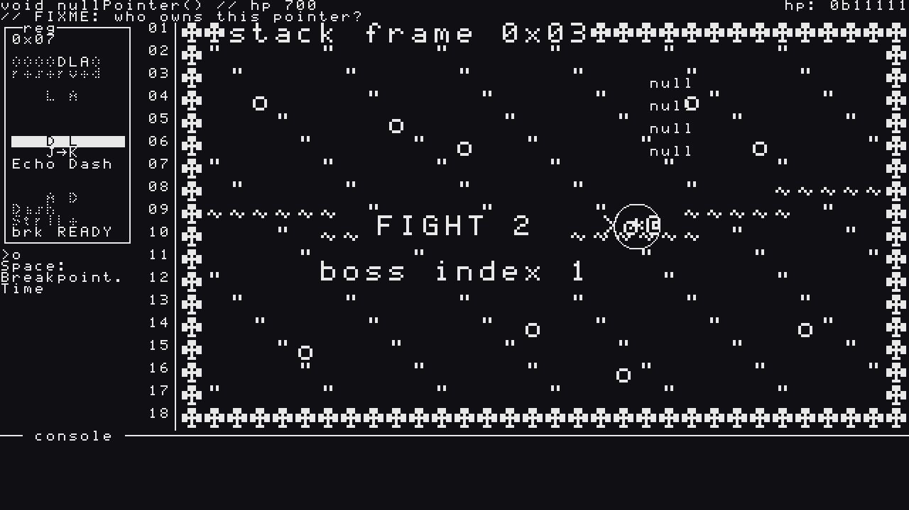
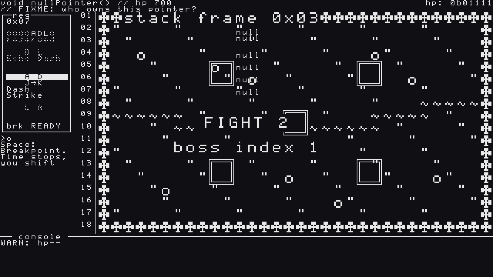
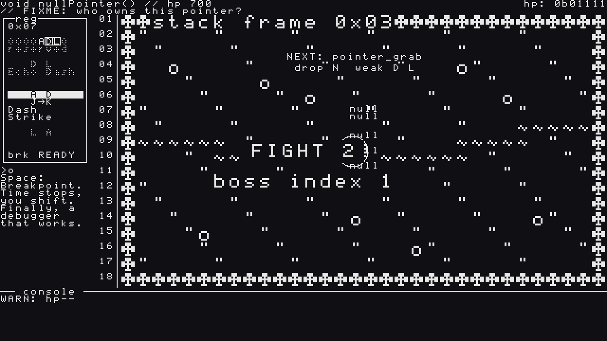

Second update on **The Debugger 0x03: Wild Shift**, my GitHub Game Off 2026 entry (theme: **SHIFT**). If you missed it, [Devlog #1](https://bstz.it/p/wild-shift-devlog-1/) covered the register and the shift. This post is a mirror of the [second devlog on itch.io](https://basteez.itch.io/wild-shift/devlog/1771895/devlog-2-its-always-the-semicolon-infinite-loop-null-pointer-and-a-duck-that-talks). You can also play the current build in the browser on the [game page](https://basteez.itch.io/wild-shift).

Two bosses down, one to go. Since the last devlog **The Debugger 0x03: Wild Shift** got its first two real bugs to fix, a duck that talks, and two new bits for the register.

## Infinite Loop: the first real bug (Epic 3)

Last time I promised a snake made of code. Here it is: **Infinite Loop**, a ring of 24 `{ }` segments biting its own tail, with an iteration counter `i = 0` floating above it.

- **It never stops.** The ring spins, drifts toward you and gets 5% faster on every lap. `i++` ticks up as it goes.
- **It's always the semicolon.** The point where head meets tail is the loop condition, a `;` that travels around the ring. Once per lap it opens for 1.5 seconds, and that's the only place you can hurt it.
- **Weak windows.** Every phase has an ordered pair of bits that "reproduces" the bug. Hit the boss with it and it's **Patched** for 3 seconds: your damage goes from ×0.5 (`// resisted`) to ×1.5 (`CRITICAL`, in caps, with a flash). Phase 1 wants `A→D` (Dash Strike through the open `;`), phase 2 wants `D→A`, so you have to shift back and forth to patch and then cash in.
- **Three phases, four attacks.** **Head Rush** (the head uncoils and charges), **Constrict** (the ring re-centres on you and shrinks: dash *through* the body to get out), and in phase 3 a **Nested Loop**: it splits into an outer and an inner ring, each with its own `;`, and they open in turn. Outer ring, `A→D`. Inner ring, `D→A`. Switching rings means switching windows. Plus a **`;` Spit** projectile, because of course.

*Infinite Loop in phase 2 (`i = 3`) closing around the player. On the left, the duck is still nagging me to shift.*

### The duck gets a voice

The rubber duck now lives in a text bubble under the register and teaches the fight with jokes: *"See the semicolon? It's always the semicolon. Hit it when it opens."* If you just stand there, it nudges you (*"Go on, shift. It's waiting."*) and after a few seconds the loop starts anyway.

The lines are typed out with a squeak and a gibberish voice made with [**mumble-speech**](https://github.com/basteez/mumble-speech), a small library of mine that turns text into gibberish speech. Its v0.3.0 added a Godot web build, so the duck can talk in the browser too. No voice acting, just a very confident duck.

### Defeat and Harvest

When the bug dies, it collapses into the line of code it should have been: `for (i = 0; i < n; i++) { }`. Then the **Harvest** screen shows the bit it dropped and the new windows it opens in your ring.

*Harvest: Infinite Loop drops LOOP. The register becomes `[A, D, L] = 0x07` and `D→L` unlocks Echo Dash.*

## LOOP, Echo Dash and Breakpoint (Epic 4)

- **LOOP (`L`) = Echo.** It replays your last solo move from where you're standing now, at 70% damage. Slash, step away, Echo: a second slash where you are. It has a 1.5 s cooldown, and if you haven't done anything yet it just does nothing (no cooldown wasted).
- **Echo Dash (`D→L`).** Dash, then Echo: a second dash you can point in a new direction, invulnerable the whole way through with no gap. It's how you pass *through* a boss, and against the next one it does more than that.
- **Breakpoint (`Space`).** Freezes the simulation for up to 2 seconds, but shifting still works. The screen dithers, a red breakpoint dot appears, and you get to think. 12 s cooldown. *Finally, a debugger that works.*
- **Duck hints.** If you're stuck, the duck tells you the weak window: `"Quack. Weak window: D→A."`. It speaks on Breakpoint (once per phase) and every third death on the same boss. In the Nested Loop phase it names the window of the ring that opens next.

## Null Pointer: a ghost that points at nothing (Epic 5)

The second bug is **Null Pointer**, a ghost made of `null` glyphs. It's **invisible**: you only see it while it attacks, for a few frames when you hit it, and for a second after an Echo Dash goes through it.

- **Finding it.** A column of falling `null` glyphs drifts under it, and it hums, panned left or right by where it is. The sky comment reads `// FIXME: who owns this pointer?`
- **Pointer Grab:** a `*` appears behind you, then it grabs. **Null Rain:** five marked areas, then `null` falls on them.
- **Dangling Pointers** (phase 2): two decoy ghosts. They don't hum, and hitting one just dispels it.
- **NullPointerException.** Swing a slash at nothing while the ghost is close and you're stunned for a third of a second. Don't attack blindly.
- **Watch (hold `R`).** Reveals the ghost and its decoys, shows the name of its next attack, the bit it will drop and its weak window. You move at half speed and can't act while you hold it, so it's a peek, not a crutch.

*Pointer Grab's tell: a `*` lands right behind the player (`@`) while the ghost closes in. `[D, L]` is live, so Echo Dash is one K away.*

*Null Rain: five areas marked, and the column of `null` glyphs that gives the invisible ghost away.*

*Holding Watch: the ghost shows up, with its next attack (`pointer_grab`), its drop (`N`) and its weak window (`D→L`).*

At the start of the fight the duck introduces the two new skills (*"Hold R. Pointers point \*somewhere\*."*). Beat it and it collapses into `if (ptr != null) ptr.deref();` and drops **NULL**:

- **Null Dodge (`N`):** half a second of intangibility, at half speed.
- **Clean Catch:** if an attack passes through you during a Null Dodge, your next damaging hit deals ×1.5, on top of Patched.

*(The "FIGHT N / boss index N" text in the middle of the arena is still a placeholder from the scene flow: it goes away in polish.)*

Fun fact: the GDD planned Epic 5 for November 18–21. It was done on November 12, so I'm almost a week ahead of schedule.

## Housekeeping

- The game is live on itch.io as a web build (about 28 MB), with a deploy from CI. Running it in a real browser found two pause bugs (resume with `P` or a click when fullscreen eats `Esc`, and a game frozen after a focus-loss pause), both fixed.
- The web build budget went from 30 to 32 MB to make room for the voice and the second boss.

## How it's made

Same as before: I'm the director and the playtester, AI agents (Claude) write the code from specs I approve with the [BMAD Method](https://github.com/bmad-code-org/BMAD-METHOD), and every story is a pull request with code review and automated tests. The test suite went from 55 to **95 test files**. Everything is public in the [GitHub repo](https://github.com/basteez/the-debugger-0x3-wild-shift).

## Next up

One bug left, and it's the worst kind. It reads and writes memory it shouldn't, and it doesn't care that the register is *yours*. Plus an intro and an ending, so the run finally has a beginning and a `return`.

Thanks for reading!
