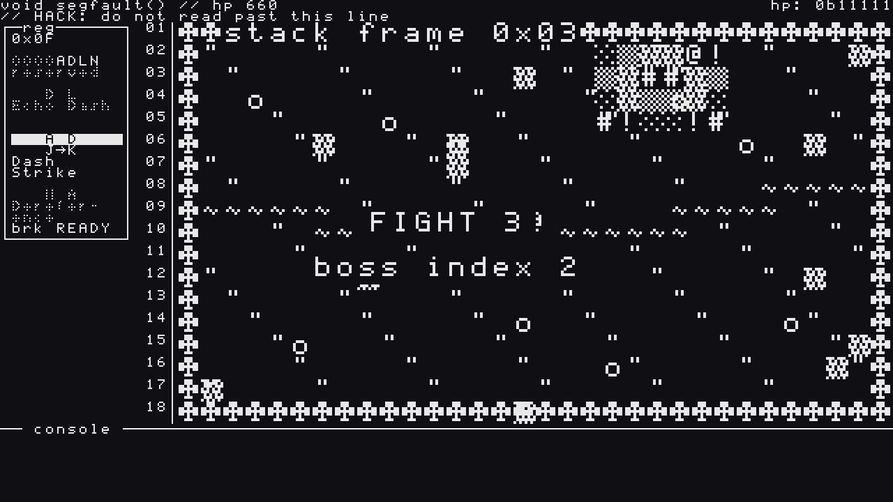
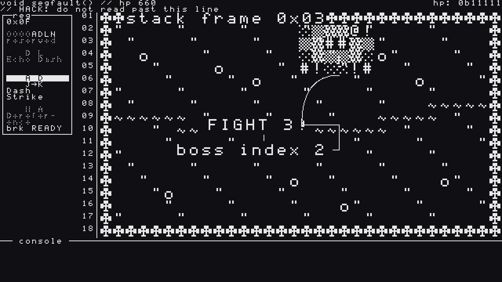
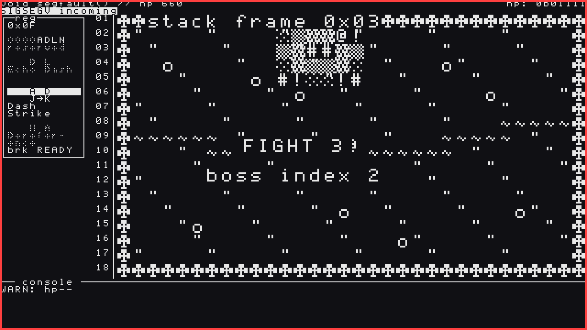
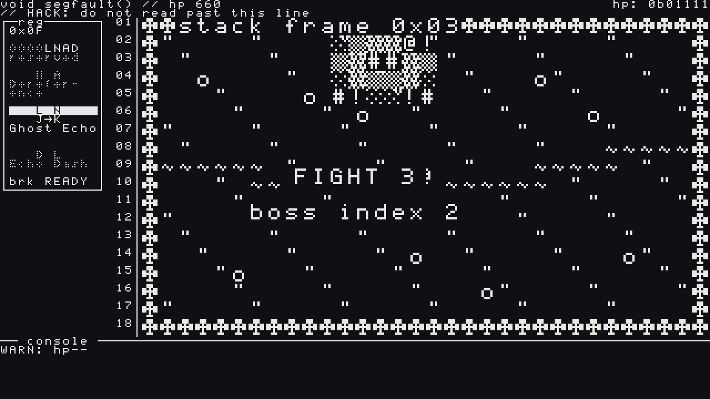
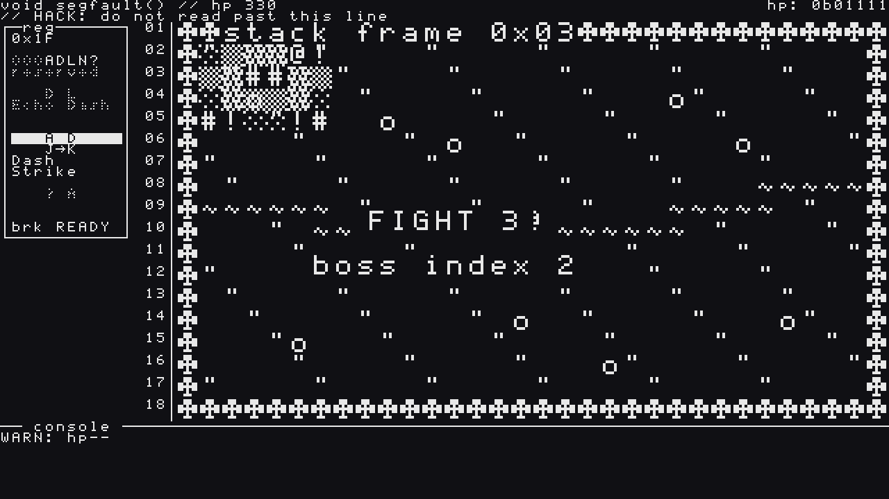
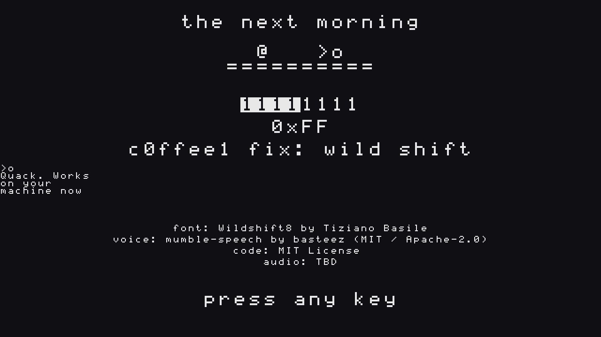

Third update on **The Debugger 0x03: Wild Shift**, my GitHub Game Off 2026 entry (theme: **SHIFT**). [Devlog #1](https://bstz.it/p/wild-shift-devlog-1/) covered the register and the shift, [Devlog #2](https://bstz.it/p/wild-shift-devlog-2/) the first two bosses. This post is a mirror of the [third devlog on itch.io](https://basteez.itch.io/wild-shift/devlog/1774453/devlog-3-sigsegv-incoming-segfault-two-new-combos-an-intro-and-an-ending). You can also play the current build in the browser on the [game page](https://basteez.itch.io/wild-shift).

The last bug is in. Since the last devlog **The Debugger 0x03: Wild Shift** got its final boss, two new combos, an intro and an ending. For the first time the run has a beginning, a middle and a `return 0;`.

## Two new combos (Epic 6)

With all four bits in the register (`[A, D, L, N]`) there are new pairs to read, and two of them are now real combos:

- **Ghost Echo (`L→N`).** Echo, then Null Dodge: you turn intangible and leave a **decoy** where you started. For two seconds the boss aims at the decoy instead of you. If an attack hits the decoy while the boss's weak window is `L→N`, the boss is **Patched**. You don't hit the boss, you let it hit itself.
- **Dereference (`N→A`).** Press K while your Null Dodge is still active and you thrust 3 tiles forward, intangible, piercing everything in the line. It's the strongest single hit in the game, and with Patched plus Clean Catch it goes from 30 to 68. Press it too late and you get a plain slash instead: *dereference after free is undefined behaviour.*

## Segfault: the bug that touches memory it shouldn't

The final boss is **Segfault**, a glitch dragon of `▓▒░#@!` glyphs, 1000 HP, crawling back and forth across the top third of the arena. The sky comment reads `// HACK: do not read past this line`, and nobody listened.

Its three phases want the three combos you've been collecting: `D→L` (Echo Dash through the claw), then `N→A` (Dereference), then `L→N` (Ghost Echo). Every combo you learned in the run has a job here.

- **Access Violation.** The claw's arc and the exact rectangle it will sweep are drawn for half a second before it swipes. Step out of the box and you're fine. Stay in it and you learn something.
- **Corrupt Memory.** 8 to 12 floor tiles get marked `░`, then turn into `▓` hazards for four seconds. Walking onto one costs 1 HP. The marks are always shown for a full second first: no damage you didn't see coming.
- **Core Dump** (phase 3). The whole floor becomes a checkerboard. Half of it is safe (`·`), half of it isn't, and you have three seconds to dance on the right squares.

*Segfault in the top band, phase 2, with Corrupt Memory's `▓` tiles spread over the floor.*

*Access Violation's tell: the claw arc and the box it's about to sweep.*

### SIGSEGV: the theme turns against you

This is the one I was waiting for. In phases 2 and 3 the screen gets a **red border** and the sky row flashes `SIGSEGV incoming`. One second later the boss **rotates your register by two slots**. `[A, D, L, N]` becomes `[L, N, A, D]`, and the combo you had under your fingers is now somewhere else.

It's always telegraphed, it never lands on top of another attack, and it's followed by a long recovery (90 frames, 150 if Breakpoint is cut) so you have time to read the new window and punish. Red is reserved for exactly two things in this game: Breakpoint and SIGSEGV.

*`SIGSEGV incoming`: red border, and the register is still `[A, D, L, N]`...*

*...one second later it's `[L, N, A, D]`, and J→K is suddenly Ghost Echo.*

### Reserved Write

In phase 3 the four `reserved` cells under the register start blinking. Then the boss writes a **garbage bit `?`** into your ring for ten seconds. `?` does nothing: its solo action is a NOP and it forms no combo with anything. Five bits, one of them useless, and the windows keep sliding. When it expires your register goes back exactly as it was.

*Reserved Write: the register reads `ADLN?` and the `? A` window is dead weight.*

Beat it and the dragon collapses into the line it should have been: `if (idx < len) buf[idx] = val;`.

## A beginning and a `return`

- **Intro.** Three quick panels, about 8 seconds: 2 a.m., stuck on a bug; squeeze the duck (`QUACK`); the screen tears into glyphs and you land in The Clearing. The duck hands you your first two bits: *"Quack. Explain the bug to me. Use these."* Any key skips it.
- **Ending.** The next morning, back at the desk. The four `reserved` cells light up one by one until the register reads `0xFF`, a commit types itself out (`c0ffee1 fix: wild shift`), and the duck gets the last word: *"Quack. Works on your machine now."* A real run also shows your clear time and how many hits you took, then the credits.

*The ending: the register finally full at `0xFF`, and the commit that fixes everything.*

The credits list my own font, Wildshift8, and the duck's voice, [**mumble-speech**](https://github.com/basteez/mumble-speech), my own library. The audio line still says `TBD`: music comes next.

*(Yes, the "FIGHT 3 / boss index 2" text in the middle of the arena is still the scene-flow placeholder. It goes away in polish.)*

## Every word in its place

The last story of the epic was a text audit. Every line of game text now lives in data and is checked against the design doc by a test: exactly **10 duck lines** (the budget I set at the start), 3 fixed lines (one per boss) and 3 sky comments. If someone adds an 11th duck line, the build fails. The duck is chatty, but within limits.

## How it's made

Same as before: I'm the director and the playtester, AI agents (Claude) write the code from specs I approve with the [BMAD Method](https://github.com/bmad-code-org/BMAD-METHOD), and every story is a pull request with code review and automated tests. The test suite went from 95 to **112 test files**. Everything is public in the [GitHub repo](https://github.com/basteez/the-debugger-0x3-wild-shift).

The plan had Epic 6 for November 22–25. It was merged on November 13, so the whole game is now playable start to finish with more than two weeks left before the deadline.

## Next up

The game is complete but quiet. Next is the part that makes it feel finished: music, the final sound pass, save and resume, a browser and performance check, and a full-run playtest with real people. If you want to help break it, the current build is playable right here on this page.

Thanks for reading!
