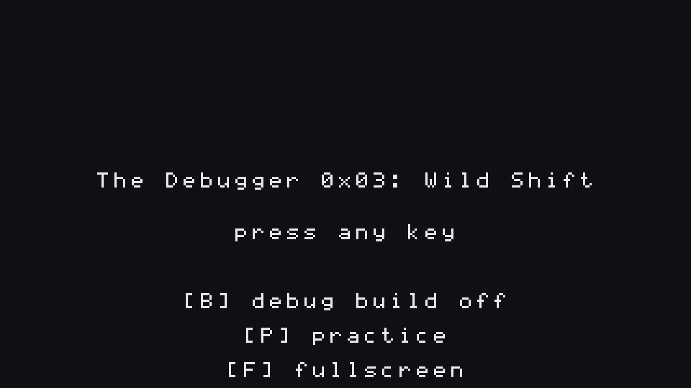
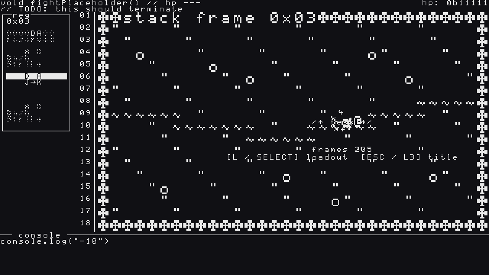
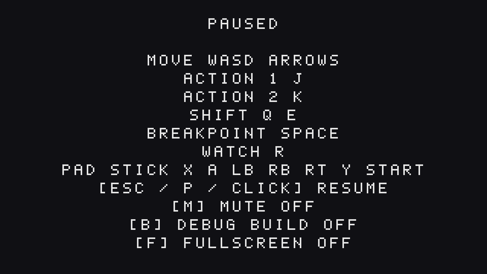

Fourth update on **The Debugger 0x03: Wild Shift**, my GitHub Game Off 2026 entry (theme: **SHIFT**). [Devlog #1](https://bstz.it/p/wild-shift-devlog-1/) covered the register and the shift, [Devlog #2](https://bstz.it/p/wild-shift-devlog-2/) the first two bosses, [Devlog #3](https://bstz.it/p/wild-shift-devlog-3/) the final boss and the ending. This post is a mirror of the [fourth devlog on itch.io](https://basteez.itch.io/wild-shift/devlog/1777465/devlog-4-dont-lose-your-run-save-gamepad-practice-mode-and-placeholder-music). You can also play the current build in the browser on the [game page](https://basteez.itch.io/wild-shift).

The game is complete, and now it has to survive other people. Since the last devlog **The Debugger 0x03: Wild Shift** got its audio plumbing, a final sound pass, save and resume, a gamepad, a practice mode and a few quality-of-life switches. Less `console.log("boss")`, more `return 0;` with a nice exit code.

## Sound (Epic 7, part 1)

- **Music plumbing.** Each fight now has its own track and the game crossfades into it. In phase 3 a glitched variant of the track fades in step with the original, and while Breakpoint is active the music drops into a muffled loop, like someone put a pillow on the speakers. Dying and retrying is an instant cut, so you never wait for a song to catch up with your second attempt.
- **Heads up: the tracks you hear right now are placeholders.** They are generated loops that only prove the wiring works. I'm composing the real ones in BeepBox, and they'll drop in under the same file names with no code change. Please don't judge the music yet.
- **Final SFX pass.** 15 sound effects, all generated procedurally by a small script, so they are mine by construction. The two shift directions now have distinct clicks, every boss attack has its own tell cue (a sound before a hit, same rule as the visual tells), and the duck got a proper squeak.

## Don't lose your run (Epic 7, part 2)

- **Save and resume.** The game remembers the highest boss you reached. The title screen resumes from there, and **[N]** starts a new run. Mute is remembered too. If saving isn't available (private window, blocked storage), it silently falls back to a normal session.
- **[B] debug build.** An optional assist toggle for people who want to see the story: 8 HP instead of 5, a shorter Breakpoint cooldown, and slower boss tells. Damage numbers stay the same. It's saved, and it's named after the only thing a debugger really wants.
- **Gamepad.** Stick or d-pad to move, face and shoulder buttons for the actions and shifts, the right trigger for Breakpoint, Start to pause. Any button advances the title, intro and ending screens, so you can play start to finish without touching the keyboard.
- **[F] fullscreen.** On the title and the pause screen, by key, click or pad.

## Practice (Epic 7, part 3)

The title screen now has **[P] practice**: a fight against the `/* test */` dummy with a hit log and a `frames N` counter, available in every build. You can cycle through loadouts with L, so you can try a combo before you have earned it in the run. It writes nothing to your save and has no intro. Esc takes you back to the title.

*The title screen with the new options. ([N] new run shows up once you have a save.)*

*Practice mode: the `/* test */` target, the hit log and the frame counter.*

*The pause screen now has mute, debug build and fullscreen rows.*

## Measuring the run

The last code story is a small playtest harness: the game prints `[metrics]` lines with the time to the first shift, the time and deaths per boss, and a total for a full run. No gameplay value changed, it only counts. I'll use it to tune what the numbers say is too hard or too easy, instead of what I feel at 1 a.m.

I also added a build-size check to CI (the web build must stay under 32 MB), and the README, credits and this page's copy are done. The credits include **mumble-speech**, my own library, for the duck's voice.

## How it's made

Same as before: I'm the director and the playtester, AI agents (Claude) write the code from specs I approve with the [BMAD Method](https://github.com/bmad-code-org/BMAD-METHOD), and every story is a pull request with code review and automated tests. The test suite went from 112 to **121 test files**. Everything is public in the [GitHub repo](https://github.com/basteez/the-debugger-0x3-wild-shift).

## Next up

What's left is the part only people can do: a full-run playtest, a browser check (Chrome, Firefox, Safari), the final BeepBox music, and the jam submission, with a deadline on November 29. If you want to help break it, the current build is playable on this page.

Thanks for reading!
