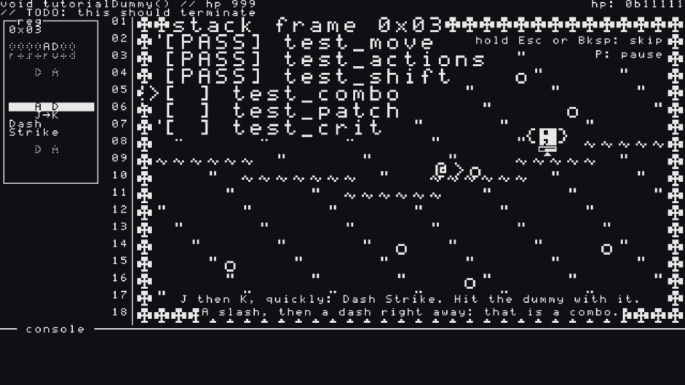
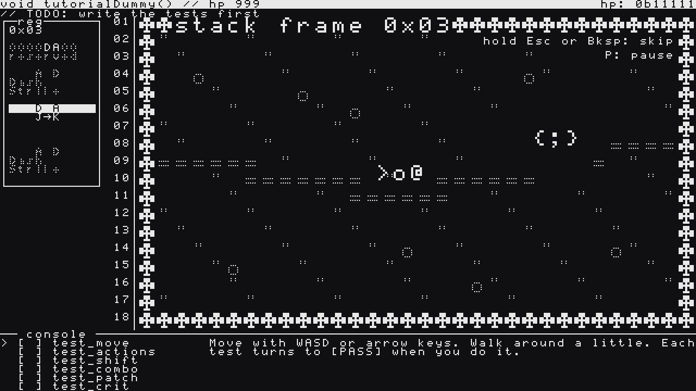
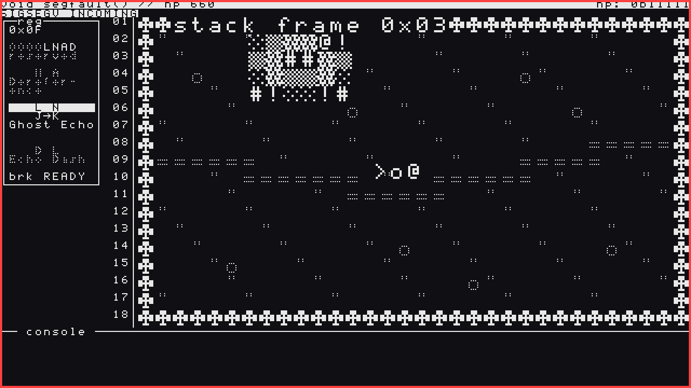

Sixth update on **The Debugger 0x03: Wild Shift**, my GitHub Game Off 2026 entry (theme: **SHIFT**). [Devlog #5](https://bstz.it/p/wild-shift-devlog-5/) covered the first playtest and the new tutorial. This post is a mirror of the [sixth devlog on itch.io](https://basteez.itch.io/wild-shift/devlog/1786885/devlog-6-i-couldnt-find-my-own-turning-the-background-down). You can also play the current build in the browser on the [game page](https://basteez.itch.io/wild-shift).

Small devlog, one bug: **I couldn't find my own player.** I was looking at screenshots of the tutorial and kept losing the `@` in the grass. When everything on screen is the same white glyph on the same black background, the player, the bosses, the tutorial text and the scenery all shout at the same volume. So this update turns the background down.

*Before: the `@`, the dummy, the checklist and the hints all blend into the grass.*

## Turning the background down

The game uses two colours, ink and near-black, and that isn't changing. What I can change is how much ink each thing gets.

- **The scenery is dithered.** Grass, rocks and water now keep one pixel in four. They read as texture, and everything drawn in full ink (you, the bosses, the tree ring around the arena) comes forward on its own.
- **Water is `=` now.** The old `~` turned into a row of slashes once it was dithered, which looked like rain. `=` dithers into a calm double line, and it's also very much a programming language.
- **Actors get some room.** Grass never grows right next to you or a boss: the ground around every actor is cleared, so nothing touches their outline.

*After: the tutorial lives in the console, and the arena only has what you need to fight.*

## Text goes where text belongs

The tutorial checklist (`[PASS] test_move`…) was drawn in big letters right on the battlefield. But it's literally the output of a test runner, so now it runs where test runners print: in the **console** under the arena. The checklist sits on the left, the current instruction on the right, and your hits (`console.log("-10")`, `CRITICAL: 30 dmg`) scroll under it. The practice mode's frame counter moved there too.

## The top bar

The two lines at the top of the screen were easy to miss, and it turned out there was a reason: the pixel font has no space above its capitals, so the first row sat flush against the edge of the screen and looked cut off. The boss signature and your `hp: 0b11111` are now an inverted title bar, like an IDE tab. The comment under it got a line for each mode too, so the tutorial says `// TODO: write the tests first`.

*Segfault's `SIGSEGV INCOMING` warning now gets its own inverted strip under the title bar.*

## How it's made

Same as before: I direct and playtest, AI agents (Claude) write the code from specs I approve with the [BMAD Method](https://github.com/bmad-code-org/BMAD-METHOD), and every story is a pull request with a code review and automated tests (**132 test files** now). This one started as a quick prototype that I could look at before anything was planned, and two rounds of "still too busy" later it became a story. Lesson from the last devlog applied: every step was checked in the exported web build, not just in the tests. That's how the sky comment got un-dithered again: at 1x, dithered text simply turns into dots.

Everything is public in the [GitHub repo](https://github.com/basteez/the-debugger-0x3-wild-shift).

## Next up

Still the same list, now with a calmer screen: a second round of playtests, the browser check (Chrome, Firefox, Safari), real music to replace my placeholder loops, and the jam submission (my target is November 29, Game Off closes December 1). The new build is live on this page. If you lose the `@` again, tell me.

Thanks for reading!
