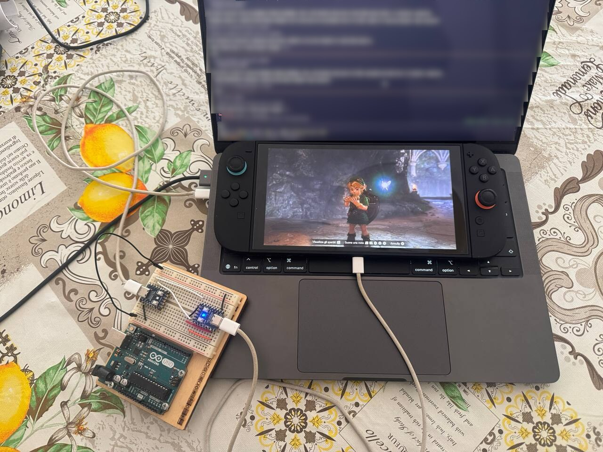
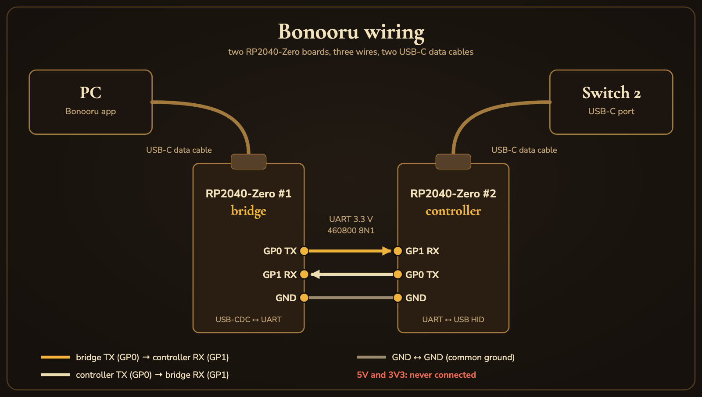
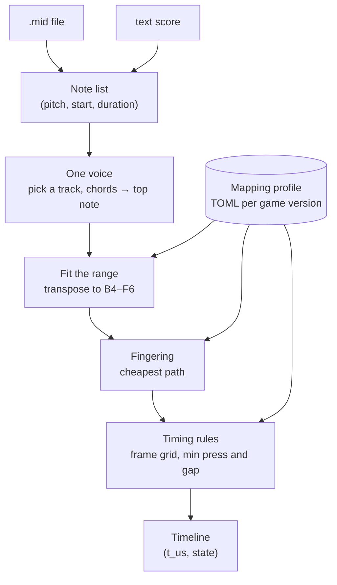

I want Link to play anything I give him on his ocarina, whether it's a MIDI file, a tune I type in, *Ode to Joy* or the theme of some other game, and I want him to do it on my own Switch 2, in the real game, with no mods and without me pressing a single button; this is the first post about how I'm building that.

*The Legend of Zelda: Ocarina of Time* came out again on Switch 2, and in this version the ocarina is played with buttons: five buttons give five notes, and the D-pad and the left stick bend them up or down, which turns it into a 19-note chromatic instrument, from B4 to F6, that you play with a controller. [Bonooru](https://github.com/basteez/bonooru) is my side project that plays that instrument for you, and it's made of a desktop app, which turns a score into a timeline of button presses, and two tiny RP2040-Zero boards, which pretend to be a wired Pro Controller and press the buttons on time. It doesn't play the game for you, it deliberately leaves the 12 official songs alone, and it doesn't touch the console or the game; it's offline, single player, and just for fun.

The name comes from the game itself: Bonooru is one of the two scarecrows in *Ocarina of Time*, the one at Lake Hylia who listens to a melody Link makes up on the ocarina and remembers it, which, for a project about teaching Link songs he doesn't know, felt like a fairly obvious choice.

The idea isn't entirely mine, either. [RiiDraw](https://riidraw.com) already uses two RP2040-Zero boards to draw pictures automatically in another Switch game, and I had it running on my console, which was a fairly strong hint that the same two boards could press ocarina buttons just as well as they draw pictures.

## Two boards and three wires

The hardware is two RP2040-Zero boards (a Raspberry Pi RP2040 chip on a board the size of a stamp), three jumper wires and two USB-C data cables, and that's really all of it, with no soldering involved.


*My setup: the two boards on the breadboard, one cable to the Mac and one to the Switch 2. The Mac screen is blurred, and the Arduino Uno underneath isn't part of it.*


*The wiring: TX to RX, RX to TX, ground to ground, while 5V and 3V3 stay unconnected. (A schematic: pins are drawn by name, not where they sit on the board.)*

```mermaid {caption="The whole system: the app on the PC, the bridge board, the controller board and the console"}
flowchart LR
  subgraph PC["PC (Windows / Linux / macOS)"]
    APP["Bonooru app<br/>Rust + egui"]
  end
  APP -- "USB-CDC<br/>(virtual serial port)" --> BR["RP2040-Zero #1<br/>bridge"]
  BR -- "UART 3.3 V, 460800 baud<br/>GP0/GP1 crossed + GND" --> CT["RP2040-Zero #2<br/>controller"]
  CT -- "USB HID<br/>wired Pro Controller" --> SW["Switch 2<br/>Ocarina of Time"]
```

The RP2040-Zero has exactly one USB port, which has to act as a USB *device* towards the Switch 2, and since the PC needs a data link of its own, the work is split between two boards: the *bridge* talks USB to the PC and UART to the other board, and the *controller board* talks UART to the bridge and USB to the console. UART here is just two data wires at 3.3 V plus a common ground, and it's the same layout RiiDraw and its firmware, 2wiCC, use, so I knew it worked on my console before writing a line of code. A USB-to-serial adapter, or a second USB port bit-banged in software with [Pico-PIO-USB](https://github.com/sekigon-gonnoc/Pico-PIO-USB), would also work; the second might come back later as an experiment.

The console also has to accept the controller board as a controller, and there were three candidates: a HORI Pokkén pad (0F0D:0092), which is plain HID with no handshake but which I'd only seen in community reports on Switch 2; a Switch 2 Pro Controller (057E:2069), whose handshake includes a key exchange that one open-source project handles; and the wired Switch 1 Pro Controller (057E:2009), which RiiDraw and 2wiCC already use on my console. I went with the last one, the only one I'd actually seen working, even if it needs "Pro Controller Wired Communication" turned on in the system settings and a small handshake that I'll write from public reverse-engineering notes. The firmware keeps the profile behind one interface, so if Nintendo ever drops it another profile can take its place without touching the protocol or the app.

The firmware for both boards is my own, in C on [pico-sdk](https://github.com/raspberrypi/pico-sdk) and [TinyUSB](https://github.com/hathach/tinyusb). 2wiCC has no licence, so I only use its published binaries for early experiments and read its sources to understand the behaviour, without copying any code, and everything in the repo is MIT.

## Keeping time

What the ocarina cares about is when each button goes down, and since the game runs at 60 frames per second, the goal is to start every note within one frame (16.7 ms) of where it should be, without drifting over a whole song. A PC can't really promise that, because Windows can delay a thread by 1 to 15 ms, USB serial buffers data, and any pause in the app ends up in the music; RiiDraw, which sends its picture frame by frame, ran into desync problems on big drawings.

The way around it is that the PC doesn't keep time at all: the app compiles the whole piece into a list of events, each one saying "at time *t*, in microseconds from the start, the controller state becomes *s*", and streams them ahead of time to the controller board, which buffers them and applies each one from a 1 MHz hardware timer. All the app has to do is keep that buffer from running empty, with credit-based flow control, where the controller board tells the app how much room it has left.

```mermaid {caption="Planned controller firmware: frames in from the UART, events out to USB on a hardware clock"}
flowchart TB
  UART["UART RX"] --> DEC["Frame decoder<br/>COBS + CRC, sequence numbers"]
  DEC --> MODE["Modes: IDLE / DIRECT / PLAYING"]
  MODE -->|SET_STATE| RT["Real-time state<br/>(virtual gamepad)"]
  MODE -->|QUEUE_EVENT| Q["Event queue"]
  TMR["1 MHz timer"] --> SCH["Scheduler"]
  Q --> SCH
  SCH --> MASK["Safety mask<br/>ocarina inputs only"]
  RT --> CUR["Current state"]
  MASK --> CUR
  CUR --> PRF["Pro Controller profile<br/>builds the USB report"]
  PRF --> USB["TinyUSB HID"]
  WD["Watchdog:<br/>link lost, app silent, USB events"] -->|go neutral| MODE
```

The one rule in the spec that outranks everything else is not to hurt the console. The wiring is only GP0, GP1 and GND, never 5 V or 3.3 V, and the firmware never touches the power path; while a song plays, the controller board only lets through the inputs the ocarina needs (L, R, A, X, Y, the D-pad and the left stick), never Home, Capture, + or −, and it refuses any controller firmware-update request from the console. If the link drops mid-song, because I trip over the cable or the app crashes, a watchdog on the controller board releases every button on its own within 100 ms, since a stuck note is merely annoying, while a button held down in a system menu is something I'd rather not find out about.

The app and the controller board speak one small binary protocol, and the bridge in the middle doesn't understand it: it's a frame-aware pipe that forwards whole frames from USB to UART, plus a heartbeat of its own so the controller board knows the bridge is still alive. Frames are COBS-encoded (Consistent Overhead Byte Stuffing, which guarantees that `0x00` never appears inside a frame, so it can mark the end of one and the receiver resyncs at the next zero after any garbage), and each one carries a CRC-16 checksum to catch corrupted bytes:

```
type:u8 | seq:u8 | len:u8 | body[len] | crc16:u16le
```

A controller state is 8 bytes, with 16 button bits, the D-pad as a hat value, two sticks and a flags byte, and those 8 bytes are the same for every profile, with only the profile module turning them into a USB report. The main messages are `HELLO` and `INFO` to start a session and check versions, `SET_STATE` for real-time input from the on-screen gamepad, `QUEUE_EVENT` to buffer timed states, `START` and `STOP` for playback, and `STATUS` so the app can show what's going on. I chose binary over a text protocol like 2wiCC's because it's smaller and the CRC catches errors, even if an ASCII line is easier to type in a terminal; for debugging, the app will get a hidden panel that shows and sends raw frames.

## From a score to button presses



The ocarina plays one note at a time and covers 19 semitones, so most music has to be squeezed into it: one voice, transposed to fit, and whatever still doesn't fit is shown note by note so the user can decide what to do with it. Many pitches can be played in more than one way, with a button plus some modifiers, so the fingering step uses dynamic programming to find the sequence that changes modifiers the least. All the game-specific numbers, which button plays which pitch, how long a press has to be, how long a note can last, live in a mapping profile, a TOML file per game version, so if a game update ever changes the mapping it will take a new file rather than new code. When I wrote the plan most of those numbers came from community guides and were marked `HYPOTHESIS`, and measuring them is what the first epic is about.

The app is written in Rust with [egui](https://github.com/emilk/egui)/eframe, one native binary per OS (Windows, Linux and macOS), with no toolchain or runtime to install and no terminal to open: you import a song, see it on a piano roll with the fingering of every note, listen to a preview on the PC and then play it on the console. There's also an on-screen gamepad to walk Link to a quiet spot and take out the ocarina, three status lights for the three links, and a wizard that flashes both boards, where you hold BOOT, plug the board in and pick its role. The look evokes the game without borrowing anything from it, so no logos, no character art and no screenshots.

My first plan was actually Python, but before committing to it I had an agent build a throwaway Rust + egui spike, with device discovery, a piano roll, an audio preview and the flasher logic, and measure it on my Mac:

| Metric | Rust + egui spike |
|---|---|
| Release binary | 10.9 MB (4.8 MB zipped) |
| Cold start to first frame | ~115 ms |
| Frame time with ~2,000 notes on screen | p95 1.5 ms |
| Idle CPU | 0.2 % |

The Python + PySide6 option would have shipped about 113 MB, with LGPL obligations and antivirus false positives from the packager, so the choice turned out to be an easy one.

## Where it's going

The roadmap tackles the hardware risks first. Before I wrote any code, the Switch 2 had already accepted an RP2040-Zero pressing A, through RiiDraw, and I'd settled on the wired Pro Controller; next comes measuring the ocarina, then my own controller and bridge firmware, the app with its status lights and gamepad, a first song on the console, timing checks on three operating systems, flashing from the app and, eventually, a 1.0, with a live MIDI keyboard and a calibration wizard as optional extras. What worried me most was that the ocarina wouldn't behave the way the community chart says, and that the scope was too big for a fun project, with the first real song only arriving halfway through; the answer to both is to check the ocarina by hand before writing any code and to get a script playing a whole melody through existing firmware as early as possible, what's usually called a walking skeleton. I'll consider 1.0 done when someone who isn't me can wire two boards, flash both from the app and play a one-minute piece covering all 19 pitches with zero wrong notes.

I plan and build Bonooru with the [BMad Method](https://github.com/bmad-code-org/BMAD-METHOD) and AI agents (Claude). It started as a set of notes in my org-roam vault inside Emacs, which became a spec with eight ADRs, then 21 architecture decisions, a UX spec with HTML mockups ([PR #1](https://github.com/basteez/bonooru/pull/1)) and finally 12 epics and 79 stories ([PR #2](https://github.com/basteez/bonooru/pull/2), [PR #4](https://github.com/basteez/bonooru/pull/4)). Every story then goes through the same loop, a story file with acceptance criteria, a dev agent that implements it, a code review and fixes I approve, and whatever needs the console I run at the console myself. The project was called "Ocarina Bot" until the end of the first epic, so some early files still carry that name.

Before writing any firmware, the next step is to grab a real controller, a tuner and a microphone and find out how the ocarina actually behaves, and, without spoiling too much, the community chart turns out to be right about the buttons and wrong about something else.

---

*This is an unofficial fan project for personal, offline fun. It is not affiliated with, endorsed or sponsored by Nintendo. The Legend of Zelda and Nintendo Switch are trademarks of Nintendo. No game code, assets or console modifications are involved.*
