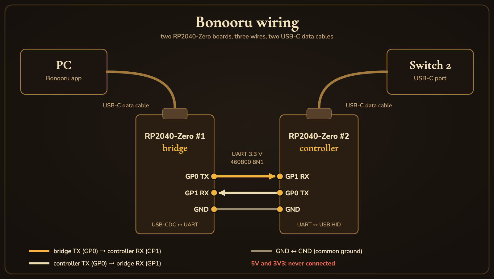
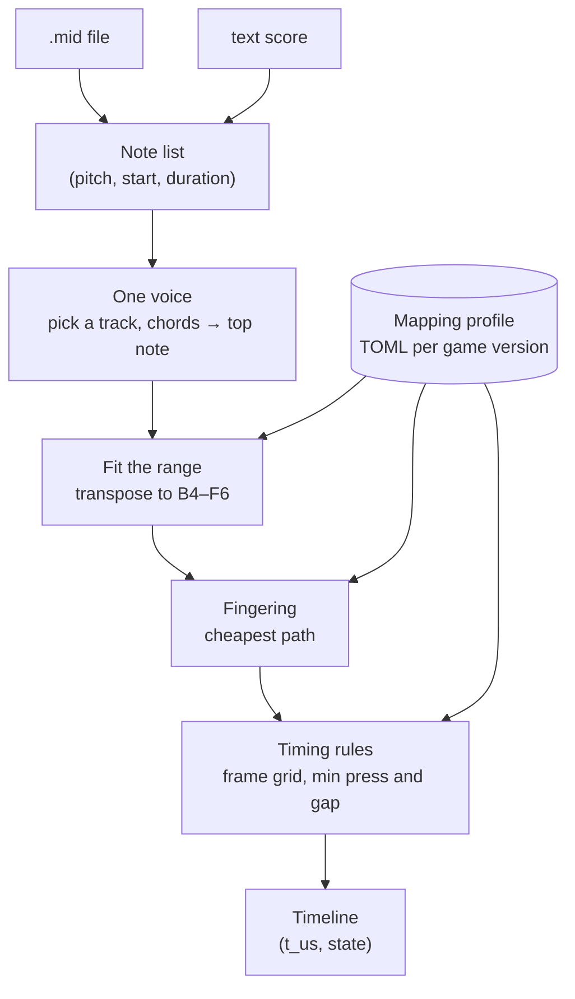

I want Link to play anything I give him on his ocarina: a MIDI file, a tune I type in, *Ode to Joy*, the theme of some other game. On my own Switch 2, on the real game, with no mod and without me pressing a single button. This is the first post about how I'm building that.

## What Bonooru is

*The Legend of Zelda: Ocarina of Time* came out again on Switch 2 in November 2026. In the game the ocarina is played with buttons: five buttons give five notes, and the D-pad and the left stick bend them up and down. That makes it a 19-note chromatic instrument, from B4 to F6, played with a controller.

**[Bonooru](https://github.com/basteez/bonooru)** is my side project that plays that instrument for you. It's a desktop app plus two tiny RP2040-Zero boards. The app turns a score into a timeline of button presses; the boards pretend to be a wired Pro Controller and press the buttons on time.

The name comes from the game itself: Bonooru is one of the two scarecrows in *Ocarina of Time*, the one at Lake Hylia who listens to a melody that Link makes up on the ocarina and remembers it. A scarecrow that learns your own songs seemed the right patron for this project.

The idea isn't mine from scratch. [RiiDraw](https://riidraw.com) already uses two RP2040-Zero boards to draw pictures automatically in another Switch game, and it works on my console. If two boards can draw, two boards can play.

What Bonooru is **not**: it doesn't play the game for you, it doesn't touch the 12 official songs on purpose, it doesn't mod the console or the game. It's offline, single player, for fun.

## The hardware

Two RP2040-Zero boards (a Raspberry Pi RP2040 chip on a board the size of a stamp), three jumper wires and a USB-C cable. Nothing else, no soldering.


*The wiring: TX to RX, RX to TX, ground to ground. 5V and 3V3 stay unconnected. (A schematic: pins are drawn by name, not where they sit on the board.)*

```mermaid {caption="The whole system: the app on the PC, the bridge board, the controller board and the console"}
flowchart LR
  subgraph PC["PC (Windows / Linux / macOS)"]
    APP["Bonooru app<br/>Rust + egui"]
  end
  APP -- "USB-CDC<br/>(virtual serial port)" --> BR["RP2040-Zero #1<br/>bridge"]
  BR -- "UART 3.3 V, 460800 baud<br/>GP0/GP1 crossed + GND" --> CT["RP2040-Zero #2<br/>controller"]
  CT -- "USB HID<br/>wired Pro Controller" --> SW["Switch 2<br/>Ocarina of Time"]
```

### Why two boards

The RP2040-Zero has exactly one USB port, and it has to be a USB *device* to the Switch 2. The PC needs its own data link too. So one board (the **bridge**) talks USB to the PC and UART to the other; the second board (the **controller**) talks UART to the bridge and USB to the console. UART here is just two data wires at 3.3 V plus a common ground. It's the same layout RiiDraw and its firmware 2wiCC use, so I knew it worked on my console before writing a line of code.

I looked at alternatives and set them aside: one board plus a USB-to-serial adapter (an extra part, and driver quirks on Windows), or one board with a second USB port bit-banged in software with [Pico-PIO-USB](https://github.com/sekigon-gonnoc/Pico-PIO-USB) (hand-wired USB and CPU load right next to the timing loop). That one might come back later as an experiment.

### Which controller to pretend to be

The console has to accept the board as a controller. I compared three options:

| Profile | USB VID:PID | Handshake | On Switch 2 |
|---|---|---|---|
| P1. HORI "Pokkén Controller" (plain HID) | 0F0D:0092 | none | community reports only |
| **P2. Switch 1 Pro Controller, wired** | 057E:2009 | USB commands + subcommands | **proven: RiiDraw and 2wiCC run on it** |
| P3. Switch 2 Pro Controller | 057E:2069 | complex, includes a key exchange | one open-source project |

I went with **P2**: it's the only one I'd seen working on my own console. It needs "Pro Controller Wired Communication" turned on in the system settings and a small handshake that I'll write from public reverse-engineering notes. The firmware keeps the profile behind one interface, so if Nintendo ever drops P2, another profile can replace it without touching the protocol or the app.

### Console first

One rule outranks everything else in the spec: **don't hurt the console.** The wiring is only GP0, GP1 and GND, never 5 V or 3.3 V, and the firmware never touches the power path. While a song plays, the controller board only lets through the inputs the ocarina needs (L, R, A, X, Y, the D-pad and the left stick), never Home, Capture, + or −. And it refuses any controller firmware-update request from the console.

## Where the timing lives

The ocarina doesn't care about your intentions, only about when each button goes down. The game runs at 60 frames per second, so the goal is to start every note within one frame (16.7 ms) of where it should be, without drifting over a whole song.

A PC can't promise that. Windows can delay a thread by 1 to 15 ms, USB serial buffers data, and any pause in the app ends up in the music. RiiDraw, which sends its picture frame by frame, had desync problems on big drawings.

So the PC doesn't keep time at all. The app compiles the whole piece into a list of events, each one "at time *t* (in microseconds from start), the controller state becomes *s*". It streams them ahead of time to the controller board, which buffers them and applies each one from a 1 MHz hardware timer. The app only has to keep the buffer from running empty, with credit-based flow control (the controller tells the app how much room it has).

```mermaid {caption="Planned controller firmware: frames in from the UART, events out to USB on a hardware clock"}
flowchart TB
  UART["UART RX"] --> DEC["Frame decoder<br/>COBS + CRC, sequence numbers"]
  DEC --> MODE["Modes: IDLE / DIRECT / PLAYING"]
  MODE -->|SET_STATE| RT["Real-time state<br/>(virtual gamepad)"]
  MODE -->|QUEUE_EVENT| Q["Event queue"]
  TMR["1 MHz timer"] --> SCH["Scheduler"]
  Q --> SCH
  SCH --> MASK["Safety mask<br/>ocarina inputs only"]
  RT --> CUR["Current state"]
  MASK --> CUR
  CUR --> PRF["Pro Controller profile<br/>builds the USB report"]
  PRF --> USB["TinyUSB HID"]
  WD["Watchdog:<br/>link lost, app silent, USB events"] -->|go neutral| MODE
```

If the link drops mid-song (I trip over the cable, the app crashes), the watchdog on the controller board releases every button on its own, within 100 ms. A stuck note on an ocarina is annoying; a stuck input in a menu is worse.

## One protocol, end to end

The app and the controller board speak one small binary protocol. The bridge in the middle doesn't understand it: it's a frame-aware pipe that forwards whole frames from USB to UART, plus a heartbeat of its own so the controller knows the bridge is alive.

- Frames are **COBS**-encoded (Consistent Overhead Byte Stuffing: `0x00` never appears inside a frame, so `0x00` marks the end, and after any garbage byte the receiver resyncs at the next zero).
- Each frame is `type | seq | len | body | crc16`, with a CRC-16 (a checksum) to catch corrupted bytes.
- A controller state is 8 bytes: 16 button bits, the D-pad as a hat value, two sticks and a flags byte. The same 8 bytes for every controller profile; only the profile module turns them into a USB report.

The main messages: `HELLO`/`INFO` to start a session and check versions, `SET_STATE` for real-time input (the on-screen gamepad), `QUEUE_EVENT` to buffer timed states, `START` and `STOP` for playback, and `STATUS` so the app can show what's going on.

I chose binary over a text protocol like 2wiCC's on purpose: an ASCII line is easier to type in a terminal, but binary is smaller and the CRC catches errors. For debugging, the app will get a hidden panel that shows and sends raw frames.

## From a score to button presses



The ocarina plays one note at a time and covers 19 semitones, so most music has to be squeezed: one voice, transposed to fit, and whatever still doesn't fit is shown note by note so the user decides. Many pitches can be played in more than one way (a button plus modifiers), so the fingering step picks the sequence that changes modifiers the least, like a dynamic-programming path through the options.

All the game-specific numbers (which button plays which pitch, how long a press must be, how long a note can last) live in a **mapping profile**, a TOML file per game version. A game update that changes the mapping means a new file, not new code.

When I wrote the plan, most of those numbers came from community guides and were marked `HYPOTHESIS`. Measuring them is the first epic, and the subject of the next post.

## The app

The app is written in **Rust with [egui](https://github.com/emilk/egui)/eframe**, one native binary per OS (Windows, Linux, macOS), with no toolchain or runtime to install. Users never open a terminal: import a song, see it on a piano roll with the fingering of every note, listen to a preview on the PC, then play it on the console. It also has an on-screen gamepad to walk Link to a quiet spot and take out the ocarina, three status lights (PC ↔ bridge, bridge ↔ controller, controller ↔ Switch), and a wizard that flashes both boards: hold BOOT, plug in, pick the role, done.

My first plan was Python. Before committing, I had an agent build a throwaway Rust + egui spike (device discovery, a piano roll, an audio preview, the flasher logic) and measure it on my Mac:

| Metric | Rust + egui spike |
|---|---|
| Release binary | 10.9 MB (4.8 MB zipped) |
| Cold start to first frame | ~115 ms |
| Frame time with ~2,000 notes on screen | p95 1.5 ms |
| Idle CPU | 0.2 % |

The Python + PySide6 option would have shipped about 113 MB, with LGPL obligations and antivirus false positives from the packager. That settled it.

The look evokes the game without borrowing from it: no logos, no character art, no screenshots. Where the setup wizard has to show a console setting, it uses an original illustration and the exact menu path.

The firmware for both boards is my own, in C on [pico-sdk](https://github.com/raspberrypi/pico-sdk) and [TinyUSB](https://github.com/hathach/tinyusb). 2wiCC has no licence, so I only use its published binaries for early experiments and read its sources for behaviour, never copying code. Everything in the repo is MIT.

## The plan

The roadmap goes hardware risk first:

| Milestone | What | State |
|---|---|---|
| M0 | The Switch 2 accepts a Zero and presses A | done, 18 Nov (RiiDraw on my console) |
| M1 | Controller profile decided (P2) | done, 18 Nov |
| M2 | Ocarina mechanics measured | next |
| M3 | My own controller firmware | |
| M4 | Bridge firmware | |
| M5 | App shell, status lights, virtual gamepad | |
| M6 | Load a song, preview it, play it on the Switch | |
| M7 | Timing validated on three OS | |
| M8 | Flashing from the app | |
| M9 | Release 1.0 | |
| M10 | Extras: live MIDI keyboard, calibration wizard | optional |

The risks I worried about most, from the risk register:

- **R1**: the ocarina doesn't work the way the community chart says (no sustain, minimum note length, free-play limits). Mitigation: check it by hand before writing code.
- **R2**: a melody happens to contain one of the 12 official songs, the game reacts and free play ends mid-piece.
- **R4**: the scope is too big for a fun project, and the first song plays only at M6. Mitigation: a "walking skeleton" right after M2, a script that plays a whole melody through existing firmware.

The success signal for 1.0: someone who isn't me wires two Zeros, flashes both from the app and plays a one-minute piece covering all 19 pitches with zero wrong notes.

## How it's made

I plan and build Bonooru with the [BMad Method](https://github.com/bmad-code-org/BMAD-METHOD) and AI agents (Claude). The project started as a set of notes in my org-roam (the first ADRs are dated 18 November 2026). From there:

1. **Spec**: the notes condensed into a spec with capabilities, constraints, non-goals and eight ADRs (architecture decision records).
2. **Architecture**: 21 binding decisions that keep the two firmwares and the app consistent, plus the link protocol, the USB emulation notes and a test plan.
3. **UX**: a design spec and an experience spec for the app, with HTML mockups ([PR #1](https://github.com/basteez/bonooru/pull/1)).
4. **Epics and stories**: 12 epics and 79 stories ([PR #2](https://github.com/basteez/bonooru/pull/2)), a readiness check and a sprint status file ([PR #4](https://github.com/basteez/bonooru/pull/4)).

Then every story goes through the same loop: a story file with acceptance criteria, a dev agent that implements it, a code review, fixes I approve. Anything that needs the console, I run at the console. The project was called "Ocarina Bot" until the end of the first epic, so the early files still carry that name.

## Next up

Before any firmware: grab a real controller, a tuner and a microphone, and find out how the ocarina actually behaves. Spoiler: the community chart is right about the buttons and wrong about something else.

The code, the specs and the measurements are all in the [repo](https://github.com/basteez/bonooru). Thanks for reading.

---

*This is an unofficial fan project for personal, offline fun. It is not affiliated with, endorsed or sponsored by Nintendo. The Legend of Zelda and Nintendo Switch are trademarks of Nintendo. No game code, assets or console modifications are involved.*
