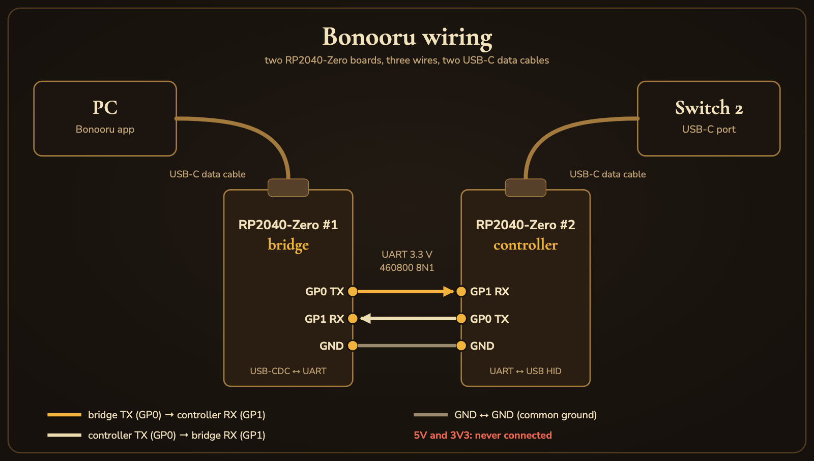
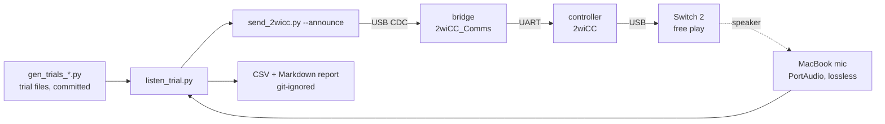

The Switch 2 just played *Ode to Joy* on Link's ocarina, 62 notes out of 62, three times in a row, without me touching the controller once and without a single line of my own firmware involved, which is an odd place for a firmware project to start; this post is about the two days of measuring that came before it.

[Bonooru](https://github.com/basteez/bonooru) is my side project to play arbitrary melodies on the ocarina in *The Legend of Zelda: Ocarina of Time* on Switch 2 by pretending to be a wired controller, and [Devlog #0](https://bstz.it/p/bonooru-devlog-0/) explains the idea, the two boards and the plan:

```
PC (desktop app)
   │ USB
   ▼
bridge (RP2040-Zero)
   │ UART
   ▼
controller (RP2040-Zero)
   │ USB
   ▼
Switch 2
```

Before this epic I had a spec, an architecture, a UX design and a backlog of 12 epics, all of it on paper, and on the hardware side two RP2040-Zero boards on a breadboard flashed with [2wiCC](https://github.com/knflrpn/2wiCC) and [2wiCC_Comms](https://github.com/knflrpn/2wiCC_Comms) by knflrpn, the two-board controller firmware that [RiiDraw](https://riidraw.com) uses; the only thing I had actually checked was that a command typed in a terminal could press A on the console. (During this epic the project was still called "Ocarina Bot", so some files linked below carry the old name.)


*The same two-board wiring as in Devlog #0. During Epic 1 the bridge ran 2wiCC_Comms and the controller board ran 2wiCC.*

The whole plan rests on facts about the game that I had only read in community guides, which buttons play which notes, how the pitch modifiers work, how short a note can be and how long it can last, and if any of those were wrong the score compiler, the mapping file and the timing rules of my firmware would all rest on guesses. So Epic 1 meant no firmware of mine and no app yet, just measuring first on my own Switch 2 and getting a melody out early enough to hear the whole thing work end to end, what's usually called a walking skeleton. It took six stories and seven PRs over two days.

## By hand, with a tuner

The cheapest test needs no hardware at all, just a real Joy-Con 2, the game in ocarina free play and a tuner app on my phone, so that's where I started ([PR #5](https://github.com/basteez/bonooru/pull/5)). The community chart says L, R, A, Y and X play D4, F4, A4, B4 and D5; the pairing was right, but every note sounded one octave higher, D5, F5, A5, B5, D6, and the same went for all 19 fingerings in the chart, so from then on the project uses the *sounding* pitch everywhere (profile, UI, docs) and keeps the chart names only to cross-reference guides. The playable range is B4 to F6, 19 chromatic pitches, with the D-pad shifting a note by ±1 semitone, the left stick by ±2 and both together by ±3.

The rest of the session was about how the ocarina behaves over time. Holding a button sustains the note, but it starts to waver after about 2 s and stops by itself at about 6 s; pressing a new button while one is held cuts the old note, and releasing the new one brings the first note back, so the old button has to be released; changing the D-pad while a note sounds steps the pitch at once, while the stick glides, so portamento is possible. Free play survived 100 notes in a row and a minute of idling without closing, and two of the answers changed actual decisions. D-pad ← is a toggle that both opens and closes the ocarina, and notes are only accepted about 2 s after opening, so the app won't take the ocarina out by itself: it can't see the screen, and an automatic press would close an ocarina the user had already opened. ZL, on the other hand, opens the song menu, ZR does nothing and the right stick moves the camera, which confirmed the allow-list for my firmware (only L, R, A, X, Y, the D-pad and the left stick reach the console while a song plays) and made masking ZL a feature rather than a restriction.

The test I was most nervous about was row 1.8. The game has 12 official songs with in-game effects, and if a melody happens to contain one the song triggers and free play ends mid-piece; my hope was to dodge that by playing one note on an alternative fingering. I played Zelda's Lullaby on natural notes and it was recognised, then with the first B as A + stick↑ and it was recognised again, then with the first D as Y + D↑ + stick↑, with the same result, so the game matches songs by pitch rather than by button, whatever the tempo, and the mitigation in the risk register went from "alternative fingering" to "warn only": the score compiler will detect official song sequences and warn about them.

## A sender for someone else's queue

Measuring timing by hand is hopeless, so I needed a script that sends timed controller states to the 2wiCC bridge ([PR #7](https://github.com/basteez/bonooru/pull/7)): a throwaway one-file Python spike, MIT like the rest of the repo, with the 2wiCC binaries used for testing only and never committed, since 2wiCC has no licence and I only read its README and sources to describe the behaviour in my own words. The wire format is ASCII lines at 460800 baud, 8N1:

| Command | Meaning |
|---|---|
| `+SPM BUF` | switch to buffered playback (power-up mode is real-time) |
| `+QD hhhhhh` | queue one 60 Hz frame, 3 digital bytes, sticks centred |
| `+QF hh…hh` | queue one frame, 3 digital + 6 analog bytes (12-bit sticks) |
| `+SPM RT` | back to real-time: the backlog is discarded |
| `+QD 000000` | neutral |

The 2wiCC queue holds 1024 frames and plays one per frame, and my input files are rows of `time buttons hat stick` in the same canonical state my own firmware will use later, with a single `encode()` function that knows the 2wiCC layout. Most of the thinking went into pacing, because if you fill the queue too much a Ctrl+C has a long backlog to throw away, and if you let it run empty 2wiCC keeps the last state, which on an ocarina means a note that never ends; so the pacer keeps the lead, frames sent minus frames played as estimated from the host clock, between 1 and 30 frames, and treats an empty queue as a hard error:

```python
first = min(self.max_lead, n)
t0 = self.clock()
self.write(lines_to_bytes([*PREAMBLE, *commands[:first]]))
self.sent = first
while self.sent < n:
    played = self.played(t0)
    lead = self.sent - played
    if lead <= 0:
        raise Underrun(f"host fell behind at frame {self.sent}/{n} (lead {lead}); stopping")
    target = min(n, played + self.max_lead)
    if target > self.sent:
        self.write(lines_to_bytes(commands[self.sent:target]))
        self.sent = target
    self.sleep(period / 2)
```
*Trimmed from [`spikes/send_2wicc.py#L431-L454`](https://github.com/basteez/bonooru/blob/2f90b00/spikes/send_2wicc.py#L431-L454)*

```mermaid {caption="One run of send_2wicc.py: preamble and prefill, top-ups every half frame, and the stop sequence on every exit path"}
sequenceDiagram
    participant S as send_2wicc.py (Mac)
    participant B as Bridge (2wiCC_Comms)
    participant C as Controller (2wiCC)
    participant N as Switch 2
    S->>B: +SPM BUF, then up to 30 × +QD/+QF
    B->>C: UART 460800 8N1
    loop every 8.3 ms
        C->>N: one frame per 16.7 ms tick
        S->>B: top up so 0 < lead ≤ 30
    end
    Note over S: end of file, Ctrl+C, SIGTERM or error
    S->>B: +SPM RT (drop the backlog)
    S->>B: +QD 000000 (neutral)
    C->>N: all buttons released
```

The stop sequence has to run on every exit, and code review found two ways a second signal could skip it, so `play()` now ignores SIGINT, SIGTERM and SIGHUP as the first statement of its `finally`, before sending `+SPM RT` and `+QD 000000`, with a regression test that fails with the old order.

In the first session commands from the PC mostly worked, but replies came back as `+2wicc��` and `+GQS<<48<�` and the stop probes were inconsistent; the culprit, a little embarrassingly, was the breadboard, where the two GND pins sat on power rails I hadn't bridged, so the boards had no common ground. Once the rails were bridged (0.1 ٠measured from GND to GND) everything behaved, a ground continuity check became step one of every session in the test plan, and every result from before the fix went in the bin. After that the L R A Y X scale played in order, D5 F5 A5 B5 D6 on the tuner, and Ctrl+C in the middle of a note stopped it at once with exit code 130; the first run of the scale didn't play at all, though, because the game was showing a "connect controller" prompt, and that turned out to be a pattern: after the controller is connected, powered on or re-plugged, the first injected input is ignored and the second one works, so from then on every session sacrificed its first A.

## The stick bends

I expected the left stick to work like a button with a threshold, where past some deflection it counts as "up" and the pitch jumps by 2 semitones, so I wrote trials to find that threshold ([PR #8](https://github.com/basteez/bonooru/pull/8)) and a helper, `listen_trial.py`, that plays a trial file while recording the MacBook microphone and reports the pitch of every press. It turns out there's no threshold at all: the stick bends the pitch gradually, close to linear in cents (1 cent = 1/100 of a semitone), about 25 cents per 0x10 step of the 8-bit stick value, with no dead zone, and reaches the full ±2 semitones only at full travel.

```mermaid {caption="Pitch bend of A5 vs left stick deflection (test plan row 1.6, one note per step, cents vs the A5 at rest). The last down step is 99 % of travel (0xFF)."}
xychart-beta
    title "Stick bend on A5"
    x-axis "Vertical deflection (% of full travel)" [0, 12, 25, 38, 50, 62, 75, 88, 100]
    y-axis "Bend (cents)" -220 --> 220
    line [0, 24, 49, 78, 105, 134, 160, 185, 199]
    line [0, -24, -50, -76, -105, -132, -159, -184, -197]
```

Half travel gives about ±105 cents, which a tuner happily reads as the next semitone but which is 5 cents away from being wrong. Diagonals were another surprise, because the stick at full travel in a corner gives about ±142 cents, the same as a diagonal on the circle, which fits the game clamping the stick vector to the unit circle and bending by its vertical component (0.707 × 200 ≈ 141); so the profile uses a pure vertical stick at full travel, `ly = 0x00` up and `ly = 0xFF` down with `lx` centred.

Then I tried all 45 combinations (5 buttons × D-pad none/↑/↓ × stick none/↑/↓), and every one gave the model pitch, button + D-pad ±1 + stick ±2, by nearest note. Nine modifier states give seven offsets, from −3 to +3, so the 45 inputs cover the 19 pitches with one to four fingerings each: G♯5, A♯5 and C6 can be played four ways, B4, C5, E6 and F6 only one. The game also isn't tuned to A4 = 440 Hz, since A5 reads about 894 Hz, roughly 27 cents sharp, and on X the D-pad shifts by about ±115 cents instead of 100; every note still reads as the right note, so I wrote both down and moved on.

### Then the microphone

The first live calibration reported no sound for an A5 that was clearly there (894 Hz, +28 c), because two problems had stacked up: the signal-to-noise ratio was computed over the whole band, where sub-200 Hz room noise dominated, and the ffmpeg avfoundation capture was silently dropping about 9 % of the samples, so the analysis windows drifted late and the "noise before the press" window contained the note itself. In a later session the same capture delivered only 78 % of real time, so it was replaced by a lossless capture through PortAudio (`sounddevice`) with its own self-test (a 1 kHz tone for 60 s, delivered-sample ratio 1.00000), and levels are now measured at the expected pitch instead of over the whole band. Something similar had already happened by hand, when one reading of the D-pad bend said 311 Hz instead of 932 Hz because the tuner had locked onto a subharmonic (932 / 3) during the change; holding both for 2 s fixed it, and in hindsight it was a fair warning of what automated pitch detection would do to me later.



## How fast it can play

The next question was how fast the bot can play ([PR #9](https://github.com/basteez/bonooru/pull/9)), which comes down to four numbers, each defined as the smallest value that passes 20 out of 20 tries. The trial generator writes every time in frames, interleaves the steps in shuffled rounds so that a step isn't always at the same phase of the game's frame, and adds a warm-up press and controls to every file: blanks, which must stay silent, a gap of 0 frames, which must read as one held note, and a gap of 30 frames, which must clearly read as two.

| What | Result | Detail |
|---|---|---|
| Shortest press that always sounds | 2 frames (33.3 ms) | 20/20 on all five buttons; 1 frame sounds only 16 to 18 of 20, and a 1-frame press still sounds for 0.1 to 0.2 s |
| Shortest release between two presses of the same button | 5 frames (83.3 ms), my choice | 20/20 at 4 frames on A, L and Y; R and X not fully resolved |
| How early a modifier must be set | 0 frames | set in the same frame as the button, no wrong pitch longer than about 35 ms, 20/20 at every lead from 0 to 5 |
| Frame rate while playing | 60 Hz (16.67 ms) | 240 fps phone video of the screen, median run of 4 identical capture frames |

The retrigger gap turned out not to be a clean yes or no: while the button is up the note decays, and the dip between the two notes deepens smoothly with the gap.

```mermaid {caption="Same-button retrigger on A: retriggers detected out of 20 per gap (test plan row 2.2; threshold 11.8 dB from the pooled controls)"}
xychart-beta
    title "Same-button retrigger on A"
    x-axis "Release gap (frames)" [1, 2, 3, 4, 5, 6]
    y-axis "Retriggers out of 20" 0 --> 20
    bar [0, 4, 19, 20, 20, 20]
```

So "retrigger" is a threshold on a continuous dip, and the threshold depends on the button; X (D6) is quiet at the microphone, with a full dip only about 13 dB above the noise, so 4 frames gave 18/20 and I couldn't tell the game apart from the microphone. I picked 5 frames for the profile and wrote down that it's a choice rather than a measured limit.

For jitter I played a 30 s passage of sixteenth notes at 120 BPM, 240 notes, through the 2wiCC queue three times: 237 to 240 notes matched each run, the error on the interval between two note starts had a σ of 8.07 to 11.67 ms (0.48 to 0.70 of a frame), p95 between 18.8 and 21.1 ms and a worst case of 22.9 ms, always under the one-frame target, with a median latency of 123 to 139 ms from the scheduled press to the sound. The per-note latency fell into two clusters one frame apart, which is what you'd expect if the game samples input once per 60 Hz frame and my host-clocked sender isn't phase-locked to it. Keep in mind that this measures 2wiCC's queue and my Mac's clock rather than my own firmware's scheduler, which gets its turn in Epic 2.

### When the analysers were wrong

Most of what I learned in this story was about measuring rather than about the game, because three of my analysers kept producing numbers that looked plausible and were wrong. The broadband signal-to-noise ratio made room noise "sound" at 5 to 14 dB and made the quiet X fail, while measured at the expected pitch X notes are 14 to 23 dB and blanks at most 6.8 dB; short-window YIN, a common pitch detector, locked onto f/2, f/3 or 2f on noisy notes, so X read as G4 or D5 and lead errors of over 1000 cents appeared out of nowhere until I switched to spectral peaks searched near the expected pitch; and generic onset detection found about 385 onsets for 240 notes, with a latency search that locked onto the wrong offsets and invented a drift, until per-button envelopes with one latency per run fixed it. Each fix has a synthetic test for its trap, and there's a caveat I also kept in the profile: these numbers come from analysers I revised after seeing the recordings, so the borderline values (1-frame presses, 2 to 3 frame gaps, the jitter σ) should be confirmed later, in the timing epic, on fresh recordings with a frozen analyser.

## A whole melody

All of the above went into the bundled mapping profile, `app/profiles/oot-switch2-1.1.1.toml` ([PR #10](https://github.com/basteez/bonooru/pull/10)), with the buttons, the modifiers, the stick bytes, the range, the timing, the fingering cost weights and all 45 fingerings, and with a tag on every value saying where it came from (`MEASURED`, `MARGIN` for a measured value plus a safety margin, `OWNER CHOICE`, `ESTIMATE` or `DESIGN DEFAULT`) plus the test plan row, so that nothing ends up labelled as measured unless it actually was.

```toml
[timing]
# MARGIN: measured 2 frames (33.3 ms), profile 3 frames (50 ms), margin +1 frame (test plan row 2.1, U7).
min_press_frames = 3
# OWNER CHOICE: 5 frames (83.3 ms), NOT a measured limit (test plan row 2.2, U2).
min_gap_same_button_frames = 5
# MARGIN: measured 0 frames, profile 1 frame (16.7 ms), margin +1 frame (test plan row 2.3, U5).
modifier_lead_frames = 1
# MARGIN: measured 6500 ms, profile 6000 ms, margin 500 ms (test plan row 1.10, U1; Story 1.6).
max_sustain_ms = 6000
# DESIGN DEFAULT (not measured): lead before the first event of a timeline.
start_lead_ms = 500
```
*Comments shortened; full file: [`app/profiles/oot-switch2-1.1.1.toml#L68-L95`](https://github.com/basteez/bonooru/blob/2f90b00/app/profiles/oot-switch2-1.1.1.toml#L68-L95)*

The 45 fingerings were transcribed from the measured table rather than generated from the model, and a test checks them against the model, so the two stay independent; pitches are MIDI numbers of the sounding pitch (A = 81 = A5), and the profile is tied to a game version, so if a patch ever changes the mapping I'll write a new file rather than new code. The `max_sustain_ms` value came at the very end of the epic, from timing held notes on A five times per length: up to 6.5 s the note lasted until the release every time, at 7 s it stopped by itself three times out of five, and the 10 s controls stopped between 6599 and 7157 ms, so the profile takes 6000 ms. I didn't measure L, R, Y and X and decided to assume they behave like A, which the profile comment says, and the session had an extra noise source, an air fryer running in the room, so any odd pitches in those recordings were dinner.

The last story was about playing a whole melody, from a hand-written note list through the measured profile to the console ([PR #11](https://github.com/basteez/bonooru/pull/11)). I picked the *Ode to Joy* theme (Beethoven, public domain) and transposed it to G major at G5 so it fits the range, 62 notes and 64 beats from D5 to D6, and a generator reads every value from the TOML, picks the chart fingering for each note and applies the timing rules.

```
# A (bars 1-4): 3 3 4 5 | 5 4 3 2 | 1 1 2 3 | 3. 2 2
B5 1
B5 1
C6 1
D6 1
...
```
*[`spikes/samples/story-1-6/ode-to-joy.melody`](https://github.com/basteez/bonooru/blob/2f90b00/spikes/samples/story-1-6/ode-to-joy.melody): sounding pitch and length in beats*

The first run at 60 BPM sounded generally good, with some notes missing; the analyser said 56 of 62 notes were audible and every audible note was at the right pitch, and the second run was the same, except that this time I watched the screen and saw that during the silent notes nothing happened at all, as if the button hadn't been pressed. So I started cutting the melody into pieces. With notes 1 to 16 shifted 4 s later and everything 2wiCC sent back logged, note 7 was cut short and note 8 was missing, the event moved with the notes rather than with the elapsed time, and the firmware said nothing at all; notes 6 to 8 on their own played fine three times out of three, while notes 1 to 8 failed in the same way twice out of two. Seventeen identical A5 notes all sounded, but I heard a longer pause after the 7th and the 14th, and I heard it before the analyser did. Then I capped every press at 400 ms, with a neutral gap before every note, and notes 1 to 8 played 8 out of 8, and the full melody 62 out of 62 after re-analysis.

As far as I can tell, with long (legato) presses the game ends a held note 0.54 to 0.91 s after it starts roughly every seventh sounded note, then ignores input for up to about a second, so a note that follows by hand-over (the next button pressed as the old one is released) gets lost. The audio really is silent, the later notes stay on schedule and 2wiCC reports nothing; I have no idea what the mechanism is, so for now it stays a hypothesis, and the workaround for the spike is staccato, every press capped at 400 ms. For the real pipeline I'd rather split long notes into repeated short presses so durations stay audible, but that's a follow-up I haven't tested yet.

There was one more missing note, and that one was on me, or rather on Beethoven. At 90 BPM, with the cap, I heard the second note of the last phrase go missing, while the analyser said every note sounded and the recording showed both B5 presses at full level: the file used Beethoven's syncopated entry, where the B5 starts on beat 4 and is tied over the bar line, and with a 400 ms cap that becomes a short early B5 followed by almost a second of silence over the downbeat, which my ear heard as a hole. I switched to the simplified rhythm most people know, with two B attacks on beats 1 and 2, the same 62 notes and 64 beats, and it finally sounded the way I remember it.

The three official runs at 90 BPM with the final file were 62 out of 62 audible and in tune each time, within −3 to +2 cents, and they sounded fine to me (the third has one raw "cut" flag on a D6 that faded to 300 of its 400 ms, which reads as the quiet X note fading rather than a drop). I haven't shown 60 BPM with the final file, the 120 BPM stress run or legato playing, and of everything in this epic, the times my ear and the analyser disagreed were the most useful: once the ear was right, with the pause after the seventh note, and once the score was "wrong", with the syncopation, and recording both side by side is the only reason I found out.

I plan and build Bonooru with the [BMad Method](https://github.com/bmad-code-org/BMAD-METHOD) and AI agents (Claude), and the spike stories were split in two: the generators, the sender, the analysers and the tests need no console, so an agent wrote them alone, while everything that needs the Switch I ran at the console myself, with the agent preparing the trial files and recording the numbers exactly as measured. At the end of the epic `spikes/` had 570 tests, none of which needs hardware, and all the measurements live in [`docs/test-plan.md`](https://github.com/basteez/bonooru/blob/2f90b00/docs/test-plan.md) and [`docs/ocarina-input-mechanics.md`](https://github.com/basteez/bonooru/blob/2f90b00/docs/ocarina-input-mechanics.md).

Everything in `spikes/` will be thrown away; what I keep from Epic 1 is the profile and the measurements, along with the slightly uncomfortable feeling of having spent two days on someone else's firmware, which is why the next devlog is about my own controller firmware on the RP2040 and the first time the Switch 2 accepts it as a controller.

---

*This is an unofficial fan project for personal, offline fun. It is not affiliated with, endorsed or sponsored by Nintendo. The Legend of Zelda and Nintendo Switch are trademarks of Nintendo. No game code, assets or console modifications are involved.*
