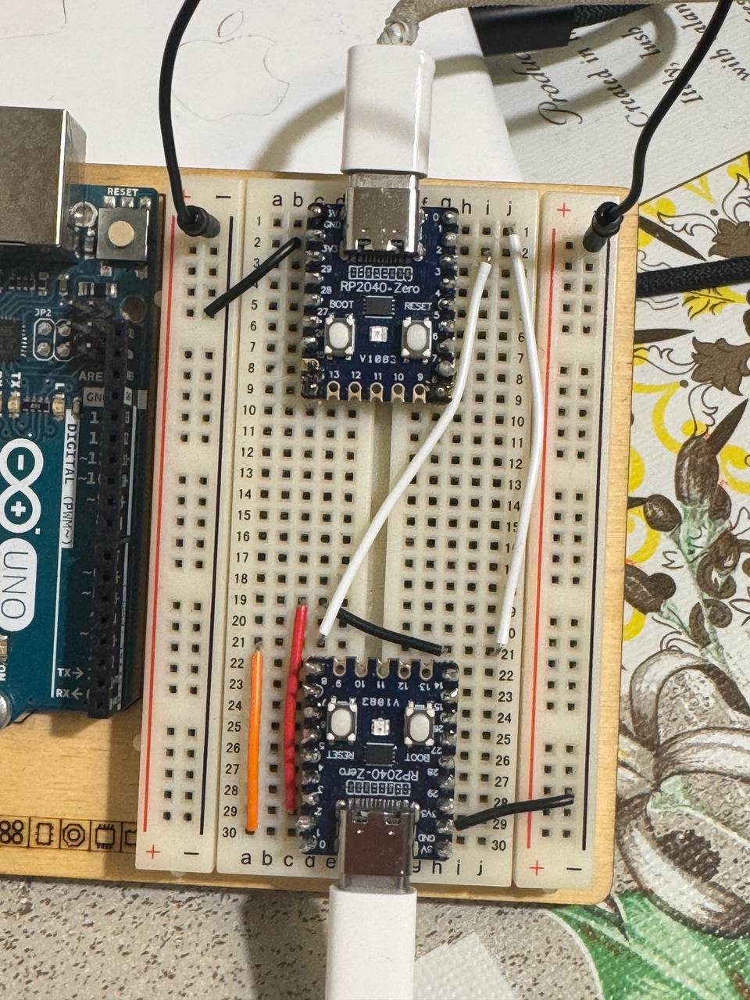
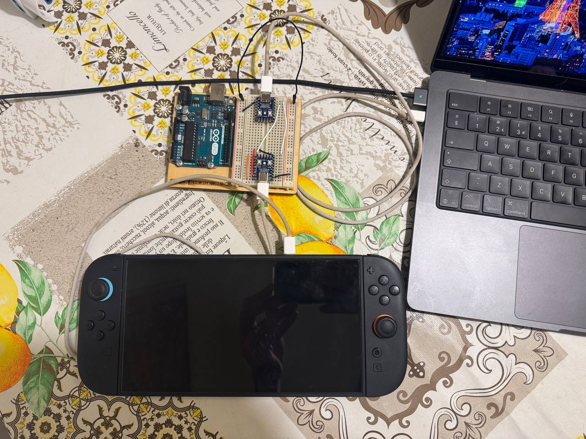
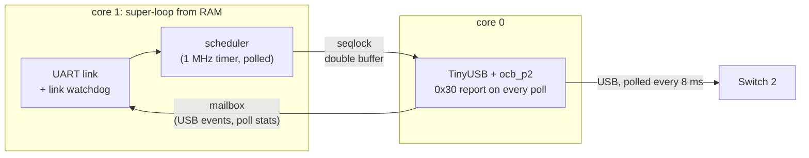
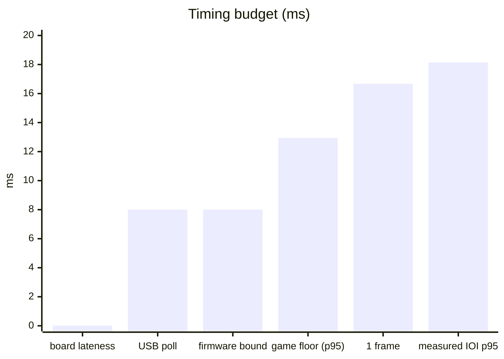
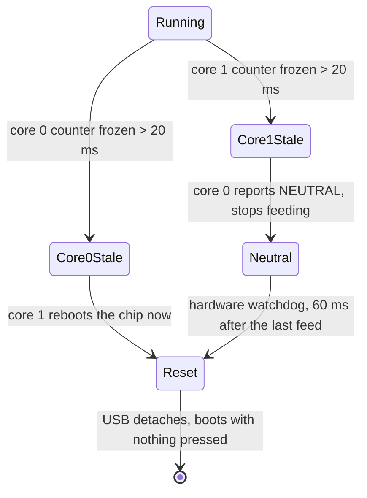

The Switch 2 now plays *Ode to Joy* on Link's ocarina from my own firmware. 62 notes out of 62, every one at the right pitch, timed by the controller board's own clock, and the firmware says it applied every note at most 14 µs late.

[Bonooru](https://github.com/basteez/bonooru) is my side project to play arbitrary melodies on the ocarina in *The Legend of Zelda: Ocarina of Time* on Switch 2. It does that by pretending to be a wired controller. The chain is a desktop app on the PC, a "bridge" RP2040 board on USB, a UART link, and a "controller" RP2040 board that the Switch 2 sees as a Pro Controller. [Devlog #0](https://bstz.it/p/bonooru-devlog-0/) explains the idea and the plan. [Devlog #1](https://bstz.it/p/bonooru-devlog-1/) is the two days of measuring the ocarina itself.

```mermaid {caption="The Bonooru chain. This epic built the controller board's firmware; the bridge is still someone else's"}
flowchart LR
  PC["PC<br/>(probe scripts today,<br/>the app later)"] -- "USB CDC" --> BR["bridge RP2040-Zero<br/>(2wiCC_Comms for now)"]
  BR -- "UART 460800" --> CT["controller RP2040-Zero<br/>(my firmware)"]
  CT -- "USB HID,<br/>Pro Controller" --> SW["Switch 2"]
```

## Where we were

At the end of Epic 1 the Switch 2 had played the same melody, but through [2wiCC](https://github.com/knflrpn/2wiCC) by knflrpn, someone else's controller firmware. I had a measured profile of the ocarina (which button plays which note, how short a press can be, how fast notes can follow each other) and nothing of my own on the boards.

The goal of Epic 2 was milestone M3: my own controller firmware enumerates as a wired Pro Controller, enforces the safety rules, and plays a hard-coded melody on the console with at most one frame of jitter. Seven stories, seven PRs ([#15](https://github.com/basteez/bonooru/pull/15) to [#19](https://github.com/basteez/bonooru/pull/19), [#23](https://github.com/basteez/bonooru/pull/23), [#24](https://github.com/basteez/bonooru/pull/24)), from 21 to 23 November.

The stories were not built in the order you'd expect. The parts that need no console came first: the build, the wire protocol, the playback core, the UART link and its watchdog. The USB side, the bit the console actually talks to, came sixth. That way, when I finally plugged the board into the Switch, everything behind the USB endpoint had already been tested on my Mac for a day.

## A skeleton that blinks

Story 2.1 ([PR #15](https://github.com/basteez/bonooru/pull/15)) is the boring one, and the one everything else stands on. pico-sdk 2.3.1 is a git submodule, with only TinyUSB 0.18.0 initialised inside it. The Arm GNU Toolchain 15.2.Rel1 and picotool 2.3.1 are pinned with their published checksums. One CMake project builds two UF2 files, `bridge.uf2` and `controller.uf2`, and a third preset builds the host tests for the PC.

At this stage each board did one thing: blink the onboard WS2812 RGB LED through a PIO driver, blue at 1 Hz for the bridge and amber at 2 Hz for the controller, so I can tell them apart on the breadboard at a glance. Every GPIO number lives in one header, `pins.h`, and CI fails if a grep finds a pin number anywhere else. That rule sounds pedantic until two boards share a breadboard and a wrong pin can drive one board's TX into the other's.

## One protocol, one library, 239 vectors

Story 2.2 ([PR #16](https://github.com/basteez/bonooru/pull/16)) wrote the link protocol as a pure C99 library, `ocb_proto`. No pico-sdk include, no heap, no global state. Frames are `type | seq | len | body | crc16le`, wrapped in COBS (Consistent Overhead Byte Stuffing, which removes every `0x00` from the frame so a single `0x00` can mark where one frame ends), and checked with CRC-16/CCITT-FALSE.

The PC app will be written in Rust later, so the library is tested against language-neutral text vectors rather than against itself: 239 cases in 7 files, covering every message, the COBS and CRC edge cases, maximum-length frames, an empty frame, a bad CRC, an overlong frame and the 8-byte neutral controller state. The Rust codec will have to pass the same files.

```text
# HELLO, seq 0: crc16("01 00 01 01") = d164, sent LE as "64 d1"
```
*One line of [`firmware/common/proto/vectors/messages.txt`](https://github.com/basteez/bonooru/blob/f999406/firmware/common/proto/vectors/messages.txt)*

The code review found one important bug here: when a COBS decode overflowed its output buffer, the decoder reported it in a different order than the architecture asks for (COBS first, then length, then CRC). Small, but it's exactly the kind of disagreement between two implementations that the vectors exist to catch, so the fix came with new vector cases that failed against the old decoder first.

## The core: what is allowed to reach the console

Story 2.4 ([PR #17](https://github.com/basteez/bonooru/pull/17)) is the playback logic, again in plain C tested on the PC with a fake clock. Three modes:

- **IDLE**: nothing is pressed.
- **DIRECT**: the PC sets the state live (to navigate menus, for example).
- **PLAYING**: the board plays a queue of timed events (up to 512, 12 bytes each) from its own clock.

```mermaid {caption="Controller modes. Every abort returns NEUTRAL and latches until the app says STOP or HELLO"}
stateDiagram-v2
  [*] --> IDLE
  IDLE --> DIRECT: SET_STATE
  IDLE --> PLAYING: START (queue loaded)
  DIRECT --> IDLE: STOP / abort
  PLAYING --> IDLE: last event (NEUTRAL + END) / STOP / abort
```

In PLAYING a safety mask lets through only the buttons the ocarina needs, so a corrupted event can never press HOME or open a menu in the middle of a song. A test pushes all 65,536 button values through the mask. Every abort (link lost, USB gone, an event that arrives too late) sends the state to NEUTRAL, clears the queue and latches, so the board doesn't resume playing by itself after a glitch.

## The UART link

Story 2.6 ([PR #18](https://github.com/basteez/bonooru/pull/18)) is the controller's side of the link: UART0 at 460800 baud, an interrupt that drains the receive FIFO including the error bits (framing, parity, break, overrun), frame decoding, a go-back-N retransmission scheme so a lost or corrupted `QUEUE_EVENT` is resent rather than skipped or duplicated, and a STATUS frame every 50 ms.

The bridge on my bench still runs knflrpn's [2wiCC_Comms](https://github.com/knflrpn/2wiCC_Comms), which copies bytes between USB and UART unchanged. It has no flow control and drops bytes silently when its 1 KB buffer fills, so my bench script paces its writes to the UART rate. The first soak failed on bugs in that script, not in the firmware; the one that passed sent 20,000 events with 2% of frames corrupted, 2% dropped and garbage in between:

| Soak run (H.5) | Events | Resends | Rewinds | Semantic errors |
|---|---|---|---|---|
| seed 1, impaired | 20,000, all in order | 36 | 1,806 | 0 |
| seed 2, impaired | 20,000, all in order | 34 | 1,772 | 0 |
| clean | 20,000, all in order | 0 | 0 | 0 |

The other part of this story is electrical. When only one of the two boards is powered, its TX pin must not push current into the other's RX. So the controller keeps its TX pin high-impedance at power-up, and only drives it after its own RX line has been idle-high for 1 ms, which means the bridge is alive. With a multimeter: TX 0 V with the controller alone, 3.28 V once the peer idles high.


*The bench: the bridge RP2040-Zero at the top (still 2wiCC_Comms), my controller firmware at the bottom, UART and GND between them. The wiring is ugly; the GND continuity was measured first.*

## The link watchdog

Story 2.7 ([PR #19](https://github.com/basteez/bonooru/pull/19)) answers a question that matters more than any other in this project: what happens if the PC or the bridge disappears while a note is pressed?

The bridge sends a `HEARTBEAT` every 20 ms. If the controller sees none for 80 ms, or sees a UART break (an unplugged wire reads as a break, because the RX pin has a pull-down), it aborts: NEUTRAL, queue cleared, an `EVENT LINK_LOST` to the app, then TX released. On the bench, three runs of the "stop the heartbeat" test gave `LINK_LOST` 81.6, 81.1 and 81.3 ms after the last heartbeat. Pulling the wire by hand, ten rounds in a row, gave one abort per round and nothing left pressed.

The test that failed here twice was, again, the bench script. A bouncing replug of the wire left half a frame in the controller's receiver, and the script never resent the event that frame had eaten. Later, the bounce of one replug arrived 77 to 104 ms after the previous round had ended and the script took it for the next unplug. The firmware did the right thing in every one of those runs. I'm starting to think that half of embedded work is debugging your own test tools.

## The Switch 2 meets a stranger

Then Story 2.3 ([PR #23](https://github.com/basteez/bonooru/pull/23)): make the controller board a USB device the console accepts.

### Clean-room, on purpose

2wiCC has no licence, so I can't read its code and then write mine; that would make Bonooru a derivative of something I have no permission to use. The Linux `hid-nintendo` driver is GPL, which would force a licence I didn't choose. So the whole Pro Controller conversation was rebuilt from public descriptions and captures, used for facts only (byte values, offsets, sequences), never for code:

- dekuNukem's [Nintendo_Switch_Reverse_Engineering](https://github.com/dekuNukem/Nintendo_Switch_Reverse_Engineering) notes: the `0x80` USB commands, the `0x30` input report, the subcommands, the SPI flash map.
- Chromium's [`nintendo_controller.cc`](https://github.com/chromium/chromium/blob/main/device/gamepad/nintendo_controller.cc) and SDL's [`SDL_hidapi_switch.c`](https://github.com/libsdl-org/SDL/blob/main/src/joystick/hidapi/SDL_hidapi_switch.c): what a host does when it opens a wired Pro Controller.
- mzyy94's [USB gadget write-up](https://mzyy94.com/blog/2020/03/20/nintendo-switch-pro-controller-usb-gadget/) and its capture log, and tmk's [`lsusb -v` dump](https://gist.github.com/tmk/9725596c6726b561ad2bf1f1e07e1523): the real descriptors and a real Switch 1 talking to a real controller.

All of it lives in `ocb_p2`, another pure C99 library: descriptors, the `0x80` commands, the subcommand answers, the emulated SPI flash, the `0x30` report. It knows nothing about TinyUSB or the RP2040, so it is tested and fuzzed on the PC. A thin TinyUSB glue on core 0 connects it to the hardware.

There is one rule the library is strict about: the console must never be able to update or rewrite my controller. SPI writes and erases answer "write protected", the MCU firmware update path and the feature reports that unlock the controller's memory are refused and counted. And refusing things is where the first attempt broke.

### Attempt 1: the pairing loop

The first time I plugged the board into the Switch 2, my bench script printed PASS: handshake done, `console_ready` 1 after 24 s, the console polling the IN endpoint every 8000 µs. No controller icon on the screen.

The debug build keeps a log of every request the console sends and leaves it inside the STATUS frames, so I could read the Switch 2's side of the handshake. It went through the expected init and then asked for subcommand `01`: Bluetooth pairing. My firmware refused it, as the "change nothing" rule said. The console asked again. And again. About 30 times, until the log was full.

```text
restart bus-reset, restart mount, usb 80 05, usb 80 01, usb 80 02, sub 03, HANDSHAKE,
usb 80 04, sub 02, sub 08, sub 10, sub 10, sub 01, REFUSED 01, sub 01, REFUSED 01, ...
```

mzyy94's full capture showed what a real controller does: it answers `01` with `81 01 03`, and the console's MCU request `21` with `A0 21` and a 34-byte standby report. Neither answer pairs, stores or configures anything, so both fit the rule. The rule was right; my reading of "refuse anything that could change state" was too broad.

```c
case OCB_P2_SC_BT_PAIRING: {
    /* D34: the console sends this during its wired init (S12: 01 04 +
     * its address and name) and repeats it until answered; a NACK
     * stalled the Switch 2 (bench H.15 attempt 1). The real controller
     * answers 81 01 03 (S12; S13 same shape). Nothing is paired or
     * stored: the host address is discarded, no state changes. */
    const uint8_t d[1] = {OCB_P2_PAIRING_STATUS};
    return reply_sub(p, OCB_P2_ACK_PAIRING, id, d, sizeof d);
}
```
*[`firmware/controller/profile_p2/p2.c`](https://github.com/basteez/bonooru/blob/f999406/firmware/controller/profile_p2/p2.c#L387-L395)*

The whole captured init, 28 output reports, is now a host test. And the debug log learned to compress repeats, so the next loop would read `sub 01, REFUSED 01, (repeated 57 more)` instead of filling the buffer.

### Attempt 2: the inputs that went nowhere

Second try. This time the console went all the way through its init, almost request for request like the Switch 1 in the capture, and finished with subcommand `30`: player lights. A console that assigns a player slot has accepted the controller. Still no icon. I pressed D-pad down five times from the bench script, every press was acknowledged, nothing moved on the HOME screen.

That one was simple once I looked: in that build the USB report was *always* NEUTRAL. The path from core 1 (where the link and the scheduler live) to core 0 (where the USB report is built) was a stub that returned NEUTRAL, waiting for Story 2.5. My presses reached core 1 and stopped there.

```mermaid {caption="The Switch 2's wired init as my firmware logged it, attempt 2 (simplified)"}
sequenceDiagram
  participant S as Switch 2
  participant C as controller (ocb_p2)
  S->>C: 80 05, 80 01 (status)
  C-->>S: 81 01 00 03 + MAC
  S->>C: 80 02 (handshake)
  C-->>S: 81 02
  S->>C: 03 30 (standard input mode)
  S->>C: 80 04 (stay in USB mode)
  Note over C: start the 0x30 report stream
  S->>C: 02, 08, 10 ×2 (device info, SPI reads)
  S->>C: 01 (pairing)
  C-->>S: 81 01 03
  S->>C: 03 30, 04, 10 ×5, 40
  S->>C: 30 (player lights)
  C-->>S: 80 30
  Note over S,C: then only the 0x30 stream, every 8 ms
```

### Attempt 3: the console waits for you

For the third attempt the debug build got a real handoff: core 1 publishes its state through a sequence lock (more on that below), core 0 reads it into the report. First a check on the Mac with no console: five D-pad presses, `Down` seen five times in the USB reports.

Then the Switch 2. Same init, `console_ready` 1 after 9.2 s. No icon, nothing in the Controllers menu. Then I sent A, and Zelda launched from the HOME screen.

That's the finding I didn't expect: **the Switch 2 doesn't show a wired controller until its first input.** It assigns a player slot, it polls the reports, but until a button is pressed there is no icon and no menu entry. I couldn't find this written anywhere public, so attempt 1's lesson ("a PASS from my script isn't a pass") almost made me chase a bug that didn't exist.


*The whole bench: the Mac drives the bridge, the controller goes into the Switch 2's top USB-C port. Screen off on purpose: no game images here. And yes, sorry about the limoncello tablecloth.*

Other things the console taught me in the same session:

- **It polls every 8 ms**, whatever the descriptor asks. Mine asks for 1 ms; the Mac polls the same build at about 2 ms. The architecture had assumed 1 ms, so that assumption is now marked refuted.
- **Sleep is a power cut.** The Switch 2 removes USB power while it sleeps, so the controller boots again on wake, and becomes ready 1.7 s after the console's first request.
- **macOS has opinions.** With "Allow accessories to connect" on "Ask", a pending prompt left the board suspended and gone from the USB tree. That failed one test until a replug.

## A melody from the board's own clock

Story 2.5 ([PR #24](https://github.com/basteez/bonooru/pull/24)) put the pieces into their final shape and played the first melody.



Core 1 runs a loop with no sleep and no interrupts of its own, polling the 1 MHz timer and applying each event when its time comes. The whole program runs from RAM (about 32 KB copied at boot), so a flash cache miss can't delay a note. The state crosses to core 0 through a sequence-locked double buffer: the writer makes a counter odd, fills the inactive slot, makes it even; the reader copies and checks that the counter didn't move in a way that means a torn copy. It tries three times, then gives up and reports NEUTRAL.

My first version of that check was wrong. An exhaustive test of every interleaving of writer and reader steps found a case where the reader accepted a slot the writer was rewriting: a torn state, half one note and half the next. The fix was to count half publishes, not whole ones. The test now runs over 7 million interleavings under AddressSanitizer in about a second. The Cortex-M0+ barrier needed a look too: GCC's `__atomic_thread_fence` compiles to `dmb ish`, an option ARMv6-M reserves, so the firmware uses the SDK's `__dmb()` (`dmb sy`), and a CI gate counts the barriers in the disassembly.

### The firmware measures itself

I have no logic analyser, so the timing is measured in two layers: the firmware times itself, and a microphone listens to the console.

The timeline build carries *Ode to Joy* from Epic 1, 158 events, generated from the measured profile. The PC only sends HELLO and START. For every applied event the firmware records how late it was against its due time; for every USB poll, the interval since the previous one. Three runs on the Switch 2 (H.18):

| Measure | Result |
|---|---|
| Lateness at apply, max (3 runs) | 10 / 14 / 10 µs |
| Lateness, mean | about 5 µs |
| Events in the first histogram bucket | 158 / 158 |
| IN poll interval: median, p95 | 8000 µs, 8000 µs |
| Core 1 loop, max | 106 to 117 µs |
| Core 1 stack, high-water mark | 1228 to 1244 B (limit 1536) |
| Retries, fallbacks, reboots | 0 |

A note can be at most 14 µs late at the board. The "late" threshold, at which the core would abort the piece, is one poll period (8000 µs): about 570 times the worst lateness seen.

### The microphone disagrees, and that's fine

Then the second layer (H.19): the Mac's microphone near the console speaker, the same melody, an onset detector comparing the gaps between notes with the score. 62 notes, 62 audible, 62 at the right pitch, within −3 to +0 cents. The 95th percentile of the inter-onset error was **18.14 ms**, which is 1.088 frames at 60 fps: above the one-frame target.

Where do 18 ms come from, if the board is accurate to 14 µs? From two things the firmware can't change:

- A state change waits for the next USB poll: anywhere from 0 to 8 ms.
- The game samples input once per frame: anywhere from 0 to 16.67 ms. For the gap between two notes, two independent errors like that give a p95 of 0.776 frame, 12.94 ms, even with a perfect scheduler.

The analysis tool computes both bounds and checks what's left over: firmware bound 8.01 ms (14 µs of lateness plus one poll), game floor 12.94 ms, residual +2.92 ms against a 4 ms allowance for the analyser's own noise. Verdict: **EXPLAINED**. The acceptance criterion allowed exactly that branch, "≤ 1 frame, or the gap explained with the self-timing data", because I knew from the start that part of the jitter belongs to the console.



The board's bar is invisible on that chart. That's the point.

## Two watchdogs, and a chip that lies about one of them

The link watchdog of Story 2.7 covers a dead PC. Story 2.5 adds the other case: a dead core. If either core hangs with a note pressed, the board must reset itself, the USB must disappear, and the console must see nothing pressed, within 100 ms.

The rules: each core watches the other's pass counter. If core 1 sees core 0 stuck for 20 ms, it reboots the chip at once. If core 0 sees core 1 stuck for 20 ms, it switches the report to NEUTRAL and stops feeding the 60 ms hardware watchdog. Worst case 20 + 60 + 5 = 85 ms, and that sum is a compile-time assertion: change a constant past 100 ms and the build fails.



To test it I built two debug flavours that hang one core on purpose 50 ms into the first note. The first bench run failed: the Mac saw the device vanish about 180 ms after the press. It turned out macOS takes about **113 ms** to notice a removed USB device, so the host can't measure a 20 ms reset. So the board now measures it: at the reset it writes the stall-to-reset interval into a watchdog scratch register, which survives the reset, and reports it after boot. Core 0 hung: **20.0 ms**, five runs out of five.

Core 1 hung: the board said **270 ms**. That's a fail, by a lot. Except the host saw NEUTRAL reports keep coming until about 77 to 79 ms after the hang, then the device vanish 115 ms later, the macOS delay again. The board was resetting on time; it was measuring wrong. To get "time until the hardware watchdog fires" I had called `watchdog_get_time_remaining_us()`, and the pico-sdk header says, for the RP2040:

> On RP2040 this method returns the last value set instead of the remaining time due to a h/w bug.

So now the firmware computes it from the last time core 0 fed the watchdog:

```c
uint32_t ocb_live_watchdog_stall_to_reset_us(uint64_t peer_last_change_us, uint64_t last_feed_us)
{
    const uint64_t reset_us = last_feed_us + (uint64_t)OCB_WDT_TIMEOUT_MS * 1000u;
    if (reset_us <= peer_last_change_us) {
        return 0u;
    }
    const uint64_t span = reset_us - peer_last_change_us;
    return span > (uint64_t)UINT32_MAX ? UINT32_MAX : (uint32_t)span;
}
```
*[`firmware/controller/core/live.c`](https://github.com/basteez/bonooru/blob/f999406/firmware/controller/core/live.c#L97-L105)*

Second run: **80.0 ms** (79,990 µs), host and board agree within 5 ms, the board came back with nothing pressed. Both within the 100 ms budget.

| Hang | Detected | Reset after the stall | macOS sees the removal |
|---|---|---|---|
| core 0 (5 runs) | by core 1, 20 ms | 20.0 ms | median 113.1 ms later |
| core 1 | by core 0, 20 ms (NEUTRAL from then) | 80.0 ms | 114.4 ms later |


## What went wrong, and what I learned

- **My refusal rule was too broad.** "Change nothing" became "refuse everything", and the console looped on the pairing request. Answering it the way a real controller does changes nothing either.
- **A green script is not a pass.** Attempt 1 printed PASS with no controller on screen. The criterion is now "the first input acted on", checked by me.
- **The console hides wired controllers until the first input.** Not a bug, but it cost an attempt.
- **The 1 ms poll was an assumption; the console polls at 8 ms.** Measured, recorded, the architecture note updated.
- **The RP2040 watchdog can't tell you how long it has left.** Read the SDK header before trusting a register.
- **The Mac adds ~113 ms to every USB removal.** The board measures its own reset now.
- **My seqlock was wrong** until an exhaustive interleaving test showed a torn read.
- **Many failures were my bench tools**, not the firmware: a soak sender bug, a missed resend after a bouncing wire, a bounce taken for an unplug, a fresh-boot check that sent HELLO before reading. Every one was fixed and re-run.

## How it's made

I plan and build Bonooru with the [BMad Method](https://github.com/bmad-code-org/BMAD-METHOD) and AI agents (Claude). Each story gets a file with its acceptance criteria and every open decision recorded; an agent implements it, a fresh-context agent reviews it, and the findings are fixed or recorded. What needs hardware is mine: I ran every bench step at the Switch and the Mac, the agent wrote the probe tools and recorded the numbers exactly as measured, including the failed attempts.

Epic 2 is 7 PRs. At the end, the firmware has 39 host tests (ctest) that run under AddressSanitizer and UndefinedBehaviorSanitizer with no hardware, plus CI gates for pin numbers, library purity, memory barriers, RAM placement and the core 1 stack. The rules, decisions and bench numbers live in [`docs/test-plan.md`](https://github.com/basteez/bonooru/blob/f999406/docs/test-plan.md), [`docs/link-protocol.md`](https://github.com/basteez/bonooru/blob/f999406/docs/link-protocol.md) and [`docs/usb-controller-emulation.md`](https://github.com/basteez/bonooru/blob/f999406/docs/usb-controller-emulation.md).

## Next up

The controller is mine now; the bridge isn't. Next epic: my own bridge firmware, and the PC driving the controller through it, end to end.

In Epic 1 a melody played through someone else's firmware. Today it plays through mine, and I know where every millisecond goes.

---

*This is an unofficial fan project for personal, offline fun. It is not affiliated with, endorsed or sponsored by Nintendo. The Legend of Zelda and Nintendo Switch are trademarks of Nintendo. No game code, assets or console modifications are involved.*
