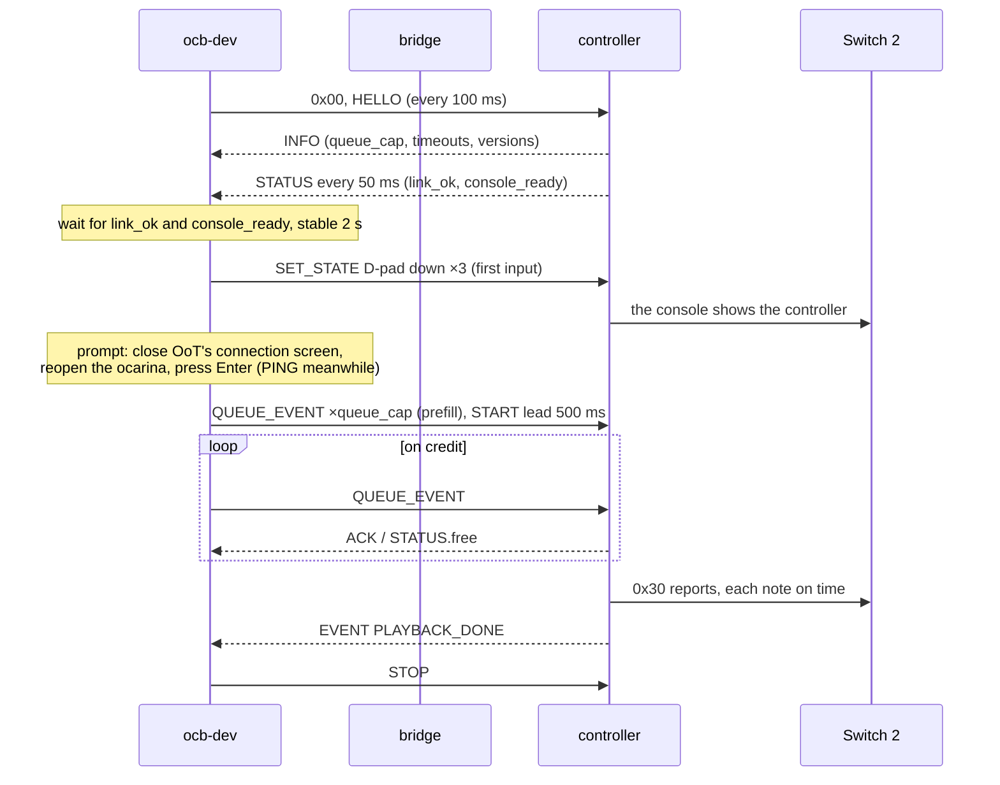
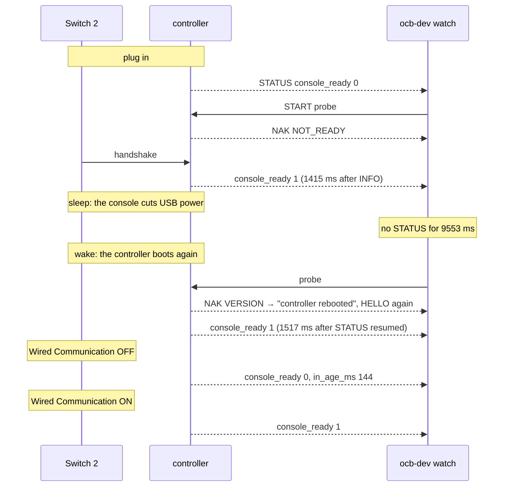

*Ode to Joy* now plays on the Switch 2 from the PC: a command on my Mac, my own bridge firmware, my own controller firmware, every note right. And if I yank the bridge out mid-song, the controller lets go of every button in about 20 ms at worst, and it measured that itself.

[Bonooru](https://github.com/basteez/bonooru) is my side project to play arbitrary melodies on the ocarina in *The Legend of Zelda: Ocarina of Time* on Switch 2. It does that by pretending to be a wired controller. The chain is a desktop app on the PC, a "bridge" RP2040 board on USB, a UART link, and a "controller" RP2040 board that the Switch 2 sees as a Pro Controller. [Devlog #0](https://bstz.it/p/bonooru-devlog-0/) explains the idea, [Devlog #1](https://bstz.it/p/bonooru-devlog-1/) measures the ocarina, [Devlog #2](https://bstz.it/p/bonooru-devlog-2/) is the controller firmware.

```mermaid {caption="The Bonooru chain after Epic 3. Every box is mine now, except the console"}
flowchart LR
  PC["PC<br/>ocb-dev (Rust)<br/>+ ocb-core session"] -- "USB CDC" --> BR["bridge RP2040-Zero<br/>(my firmware)"]
  BR -- "UART 460800<br/>+ HEARTBEAT every 20 ms" --> CT["controller RP2040-Zero<br/>(my firmware)"]
  CT -- "USB HID,<br/>Pro Controller" --> SW["Switch 2"]
```

## Where we were

At the end of Epic 2 the controller board was mine: it enumerated as a wired Pro Controller and played a melody baked into its own firmware. But the PC only sent HELLO and START, and the bridge board still ran knflrpn's [2wiCC_Comms](https://github.com/knflrpn/2wiCC_Comms), which copies bytes between USB and UART with no idea of what a frame is.

The goal of Epic 3 was milestone M4: **the PC drives the controller through the bridge.** That meant three new pieces of software and one question:

- my own bridge firmware, frame-aware, with a heartbeat that doesn't depend on the PC;
- the app's protocol code in Rust, speaking exactly the same wire format as the C firmware;
- a link session that handles retries and credits, and a small tool that streams a melody through it;
- and the question that matters for my console: when something breaks mid-song, does the controller really go neutral in time?

Five stories, five PRs ([#31](https://github.com/basteez/bonooru/pull/31) to [#35](https://github.com/basteez/bonooru/pull/35)), plus the retrospective ([#36](https://github.com/basteez/bonooru/pull/36)), from 24 to 26 November.

Like in Epic 2, the order wasn't the obvious one. The two stories that need no hardware went first: the Rust codec (3.2) and the link session (3.3). Then the bridge firmware (3.1), then the end-to-end tool (3.4), then the fail-safe measurements (3.5). By the time anything Rust touched a serial port, it had been tested for a day against a fake controller.

## Rust that speaks C: `ocb-core`

Story 3.2 ([PR #31](https://github.com/basteez/bonooru/pull/31)) started the `app/` Cargo workspace, pinned to Rust 1.100.0, with one library crate: `ocb-core`. Its `protocol` module is the Rust twin of the C library from Devlog #2: COBS, CRC-16/CCITT-FALSE, frame encode and decode in the same receive order, every message type, the 8-byte controller state.

Two rules make this crate what it is:

- **Zero runtime dependencies.** COBS, CRC and a codec are small enough to write; `proptest` is the only dev-dependency.
- **Pure.** No I/O, no threads, no clocks, no `unsafe`, no printing. A test scans the crate's source and fails if any of that appears.

The point of the C library's 239 text vectors in 7 files was exactly this moment: a second implementation in another language. The Rust test reads all seven files and must pass every case, and checks that its `PROTO_VERSION` matches the vector headers. `proptest` round-trips COBS, frames, the receive splitter and messages on random input, and checks that no decoder panics on arbitrary bytes. CI runs it all on Ubuntu, Windows and macOS, with `clippy -D warnings` and a `cargo-deny` licence check.

The code review had an interesting result. One reviewer compared the Rust codec with the C one on about 100,000 generated inputs: COBS, frame decoding, the splitter's events and counters, the message length rules. **No difference.** Every important finding was in the *test gates*, not in the codec. The purity gate, for example, was a text search that `use std as s`, `std :: fs` or a path split over two lines walked straight past. It now scans a token stream, and each of its 34 bad fixtures names the exact hit it must produce.

That's a theme for the whole epic, so I'll say it once here: a test that can't fail is worse than no test, because it tells you something is checked when it isn't.

## A session that never touches a port

Story 3.3 ([PR #32](https://github.com/basteez/bonooru/pull/32)) is the part I'm proudest of, and you can't see it on any screen.

The link protocol has rules: a session opens with HELLO until the controller answers INFO; events are sent go-back-N with cumulative ACKs and a 50 ms resend; the app may only send as many `QUEUE_EVENT`s as the controller has room for (credits from `STATUS.free`); a semantic NAK abandons the piece; a mid-session `NAK VERSION` means the controller rebooted. All of that lives in `ocb_core::link::Session`, and the session **never touches a port or a clock**. It takes bytes and a time, and gives back bytes, events and the next time it wants to be called. It's the sans-IO style of [quinn-proto](https://github.com/quinn-rs/quinn), the QUIC library that keeps its protocol logic separate from any socket.

```mermaid {caption="Sans-IO: the session is pure logic; the adapter owns the port and the clock"}
flowchart LR
  subgraph AD["adapter (ocb-dev today, the app's serial worker later)"]
    P["serial port"]
    CLK["clock"]
  end
  subgraph S["Session (ocb-core, no I/O)"]
    direction TB
    IN["handle_rx(bytes, now)<br/>handle_timeout(now)<br/>queue_event / start / stop / set_state"]
    OUT["poll_transmit(now) → bytes<br/>poll_event() → LinkEvent<br/>poll_timeout() → next wake-up"]
  end
  P -- "bytes read" --> IN
  CLK -- "now_us" --> IN
  OUT -- "bytes to write" --> P
```

Because the session is pure, it can be tested with a fake clock against a fake controller, deterministically, thousands of times. That fake controller is its own dev-only crate, `ocb-sim`, with an impaired channel that drops, corrupts, duplicates, reorders and injects junk. One sample run, 2000 events through a controller queue of only 5 slots, with every impairment at 10 %:

| Impairment run (C.7, seed 2) | Frames dropped | Flipped | Junk | Duplicated | Reordered | Resends | Rewinds |
|---|---|---|---|---|---|---|---|
| clean | 0 | 0 | 0 | 0 | 0 | 0 | 0 |
| drop 10 % | 291 | | | | | 50 | 178 |
| everything at 10 % | 577 | 498 | 534 | 510 | 513 | 480 | 554 |

Every event arrived exactly once, in order, in every run.

### The review found what the simulator couldn't

All tests green, then the code review found nine important bugs, and reproduced most of them with scratch tests. Two of my favourites:

- **STOP could steal a seq.** With more than 256 frames queued, STOP took a sequence number that was still in use by a frame in flight. An old ACK then looked like STOP's ACK: the session reported "stopped" while the controller kept playing, and later frames vanished silently. Fix: sequence numbers are given when a frame first goes out, not when it's queued.
- **A long piece never started.** `QUEUE_EVENT`s waiting for credit blocked everything behind them, including START. A piece longer than the controller's queue (512 events) would wait for credit that only START could free. The same bug froze the live gamepad in DIRECT mode. Fix: control frames have their own queue and never wait behind events.

And the finding that explains the others: **the simulator was kinder than the firmware.** The test driver read the session's own counters to check the session, called its timers every millisecond whatever it asked for, and the fake controller answered more politely than the real one does. So the driver now checks invariants from the wire only, decodes every byte the session sends, keeps strict timers, reorders across steps, and the fake controller copies the firmware's TX priority, its reply rings and its fallbacks. Each fix has a regression test that fails on the old code.

## My own bridge

Story 3.1 ([PR #33](https://github.com/basteez/bonooru/pull/33)) replaced 2wiCC_Comms with my bridge firmware. It's split like the controller: a pure C core (`bridge/core`, testable on the PC, loadable from Python) and a thin platform layer with TinyUSB and the UART. One core, one non-blocking super-loop. No code path is allowed to block.

What it does:

- **Identity.** USB CDC with VID:PID `2E8A:000A`, product string `Bonooru Bridge`, the flash unique ID as serial number, so the app can tell my board from any other serial port.
- **PC → UART, frame-aware but not decoding.** It only scans for the `0x00` delimiter. Whole frames go to the UART, one in flight and one queued; a third stays in USB until a slot frees, so USB backpressure is the flow control. An overlong run is dropped and counted.
- **UART → PC, best effort.** Bytes from the controller are copied to USB as space allows and dropped (counted) only when a 512-byte ring is full. The app's go-back-N repairs lost replies.
- **Heartbeat.** A hardware alarm ticks every 20 ms, whatever the USB state. A `HEARTBEAT` frame goes out at the next frame boundary, *ahead* of queued app frames, with the bridge's version and the PC's DTR line in its flags. This is what the controller's link watchdog from Devlog #2 listens to: if the PC hangs, the bridge keeps the link alive; if the bridge dies, the heartbeat stops.
- **1200-baud touch.** Opening the port at 1200 baud reboots the board into BOOTSEL (the RP2040's USB bootloader), so it can be reflashed without holding a button. That's pico-sdk's `pico_usb_reset`, not my code.

### Where the heartbeat can be late

"Ahead of queued app frames" doesn't mean "instantly". A due heartbeat still waits for the frame in flight, whatever is already in the UART's software ring, the 32-byte hardware FIFO and the shift register. The controller declares the link dead after 80 ms of silence, but the protocol promises a gap of at most 27 ms between heartbeats. At 460800 baud a byte takes about 21.7 µs, so every byte allowed to wait in front adds up.

My first limit, 16 bytes ahead in the software ring, left a margin of 0.25 ms and nothing to stop someone from raising it. The review made it 8 bytes, and the build now refuses any value that could break 27 ms:

```c
/* A due heartbeat waits at most for one maximum frame in flight, the bytes
 * allowed ahead in the UART software ring, the 32-entry FIFO and the shift
 * register (10 bits each at OCB_LINK_BAUD): every gap must stay within
 * OCB_HEARTBEAT_MAX_GAP_MS (AD-4, F.7). */
#define OCB_BRIDGE_HB_WORST_US                                                                     \
    (((uint64_t)OCB_MAX_WIRE_FRAME + OCB_BRIDGE_UART_AHEAD_MAX + 33u) * 10u * 1000000u /           \
         OCB_LINK_BAUD +                                                                           \
     1u)
typedef char ocb_ct_bridge_hb_gap[((uint64_t)OCB_HEARTBEAT_PERIOD_MS * 1000u + OCB_BRIDGE_HB_WORST_US <=
                                   (uint64_t)OCB_HEARTBEAT_MAX_GAP_MS * 1000u)
                                      ? 1
                                      : -1];
```
*[`firmware/bridge/core/bridge.c`](https://github.com/basteez/bonooru/blob/96685f3/firmware/bridge/core/bridge.c#L13-L24): a negative array size is a compile error*

The host test (F.7) runs 23 bursts of 512 maximum-size frames with a fake clock and measures every heartbeat gap: **17.36 to 23.07 ms**, limit 27. Its first version passed for the wrong reason. The model rounded every character to the clock's 5 µs step (25 µs instead of 21.7), and a heartbeat plus three maximum frames then took exactly 800 characters, 20.000 ms. Every gap read 20.000 ms and the worst case was never exercised. Exact character times fixed it, and the test now also *requires* a gap above 20.5 ms, so it can't pass vacuously again.

### Who powers up first

Two boards, two USB cables, and a UART between them. Either can be powered first, and a board must never push current into an unpowered neighbour through its TX pin. The controller's side of that rule (TX high-impedance until RX idles high) is in Devlog #2. Story 3.1 added the bridge's side, the probe:

```mermaid {caption="The bridge's probe (AD-20). No heartbeat while probing: TX is not driven"}
stateDiagram-v2
  [*] --> Probing: power-up, TX high-Z, RX pull-down
  Probing --> Probing: TX idle-high 5 ms every 500 ms (1 % duty)
  Probing --> Linked: RX high for 1 ms, or a valid controller frame
  Linked --> Released: break, or RX low > 2 ms
  Released --> Probing: TX high-Z for 10 ms (the controller sees a break)
  note right of Linked: first byte after link-up is a lone 0x00
```

The review found that my first version, on a link loss, started the next pulse in the same step: TX never actually went high-impedance, and the leftovers of the cut frame were still sent. Now a loss releases TX at once, empties the ring and waits 10 ms so the controller sees a break and releases too. And every link-up starts with a lone `0x00`, which ends any half frame the controller's receiver might still hold.

### At the bench

| Row | What | Result |
|---|---|---|
| H.21 | identity, LED, 1200-baud touch | `2E8A:000A`, `Bonooru Bridge`, serial = flash ID; 1200 baud → BOOTSEL in 1.60 s; 9600 / 115200 / 460800 ignored |
| H.22 | link and soak through my bridge | `link_ok` 1 from the bridge's heartbeat 14 ms after opening; impaired soak 20,000 events once and in order; 300 s hold, 5999 STATUS, 0 watchdog trips |
| H.23 | DTR drop in DIRECT | abort seen 50 ms later, `NAK ABORTED`, recovery |
| H.1 | power-up orders, 5 each way | bridge first: link up 0 to 108 ms after the controller enumerated; controller first: 34 to 43 ms after the bridge's port appeared; 10/10 PASS, no deadlock |
| H.1 | controller unpowered, bridge probing | controller 3V3 0 V, GP1 0.08 to 0.14 V (5 ms pulses on a slow meter): no back-powering |

One surprise, and not from the firmware: **macOS completes the Pro Controller handshake by itself.** With the controller plugged into my Mac, STATUS said `console_ready` 1 with no probe script running. My bench command expected "not ready" and printed one FAIL, with exactly the right replies for a ready console. The Epic 2 retrospective had already written that fact down; the H-row hadn't caught up. Now every bench row states which host the controller is plugged into.

## `ocb-dev`: the whole chain, end to end

Story 3.4 ([PR #34](https://github.com/basteez/bonooru/pull/34)) is a small command-line tool, `ocb-dev`, the first real user of the session. It takes exactly two arguments, a serial port and a timeline file, and it's the first form of the serial worker the real app will have in Epic 4.

```text
ocb-dev /dev/cu.usbmodem101 app/tools/ocb-dev/timelines/ode-to-joy-90bpm.csv
```

The timeline is the same *Ode to Joy* the controller played from its own memory in Devlog #2: 62 notes, 158 events, generated from the ocarina profile measured in Epic 1. Same melody, so the comparison is fair; the only difference is that now every event crosses the wire from the PC.

The tool is the adapter from the sans-IO diagram. Its loop sleeps until the session's next timeout, a deadline or incoming bytes, then feeds the session and drains it:

```rust
let read = self.io.read(wake, &mut buf);
// ...
if !buf.is_empty() {
    self.tap.feed(&buf);
    self.s.handle_rx(&buf, now);
}
// ...
if self.s.poll_timeout().is_some_and(|t| t <= now) {
    self.s.handle_timeout(now);
}
while let Some(chunk) = self.s.poll_transmit(now) {
    if let Err(e) = self.io.write(&chunk) {
        self.port_lost = true;
        return Err(e);
    }
    self.written += chunk.len() as u64;
}
while let Some(e) = self.s.poll_event() {
    self.on_event(e, now);
}
```
*[`app/tools/ocb-dev/src/runner/mod.rs`](https://github.com/basteez/bonooru/blob/96685f3/app/tools/ocb-dev/src/runner/mod.rs#L292-L338), trimmed*

The runner is generic over the port, the clock and "the owner" (me, pressing Enter). The bench uses a real serial port and a real clock; the dry run plugs the same runner into `ocb-sim` with a fake clock and a scripted owner. Same code, two worlds.


*B forwards every frame and adds its own HEARTBEAT every 20 ms; it's left out of the arrows to keep the picture readable.*

The "first input" step is a lesson from Devlog #2: the Switch 2 doesn't show a wired controller until it gets an input. The tool presses D-pad down three times (never A, which could launch something), then asks me to dismiss the game's controller screen and reopen the ocarina, keeps the link alive with `PING`, and starts only when I press Enter.

### Bugs moved from the bench to the desk

The Epic 2 retrospective left one action, #27, that I took seriously: before any bench session, review the bench tools and the commands of every bench row, and dry-run every new or changed tool against the simulated model. Half of Epic 2's failures had been my own test scripts, at the Switch, with the console in my hands.

For `ocb-dev` the code review found twelve important issues, and the dry run made each one a failing test before the fix. Two would have wasted a bench session:

- **An Enter typed before the prompt started the piece.** The stdin thread queued lines from launch, so a stray Enter would start the melody while the console was still on the connection screen. Now input is discarded right before the prompt.
- **The soak baseline was taken at session start.** A bounce or a CRC NAK while waiting for the console would have failed a clean 10-minute soak. Now the baseline is the last STATUS before START.

### At the bench

- **H.24, the melody.** Run 1 printed PASS, but I don't count it: the way I dismissed the connection screen gave control back to the original Joy-Con, and the screen came back during the piece. Run 2: three D-pad presses, START with a 500 ms lead, 158 events, `PLAYBACK_DONE`, no NAK. Every note right. *Ode to Joy* played on the Switch 2, streamed from the PC, through two boards running my firmware.
- **H.25, Ctrl+C mid-piece.** The agent's first SIGINT hit its own wrapper shell instead of the tool, so the interrupt arrived about 20 s into the melody instead of 5. The tool printed `INTERRUPTED: STOP ACKed, controller mode Idle (neutral)` and exited 130. The melody stopped at once, no held note.
- **H.27, port rules.** On macOS the tool refuses `/dev/tty.*` and names the `/dev/cu.*` port to use instead (the `tty` device waits for a carrier signal that a USB serial port never raises).

### Ten minutes at 460800

The M4 exit criterion was a soak: 10 minutes at 460800 baud without losing a byte, or else evaluate 921600. `ocb-dev <port> soak` streams one event per millisecond, about 100 times the rate of a melody, with states harmless on any host. It runs with the controller on the Mac, on the debug build that exposes the controller's counters.

```text
SOAK: 600.7 s, 600000 events, 11400018 bytes written (41.2 % of 460800 baud), transport NAKs 0
```

| Debug counter (before START → after STOP) | Value |
|---|---|
| `dropped_bytes` | 1 → 1 (the boot break) |
| `rx_err_bytes` | 1 → 1 (the same break) |
| `rx_overflow_bytes`, `overlong_bytes`, `tx_dropped`, `watchdog_trips` | 0 → 0 |

600,000 events, zero bytes lost, zero transport NAKs. **921600 baud isn't needed.** The only bench bug was cosmetic: the summary line printed `frames sent 0`, because the session restarts its counters at every STOP. Fixed after the bench, with a test that failed on the old code.

## Pulling the plug, 40 times

Story 3.5 ([PR #35](https://github.com/basteez/bonooru/pull/35)) had no new feature. It was the one I cared about most: **can I trust these boards with my console?** The requirement: when the link dies mid-song, the console must see nothing pressed within 100 ms, every time.

`ocb-dev` got two more keyword modes: `failsafe` plays the melody in rounds and waits for me to break the link in each one; `watch` follows the console's state while I put it through sleep and settings changes.

### When the tool can't measure the criterion

The review found something uncomfortable: **two numbers in the acceptance criteria could not be measured** with what the controller exposed.

- "Neutral within 100 ms": the tool could see *that* the watchdog fired, not *when*.
- "`console_ready` back to 0 within 150 ms of switching wired communication off": the tool measured the gap between two STATUS frames, not the moment the console stopped polling.

My original plan had been "no firmware change, the design already bounds it". At the review I changed my mind and added a measurement to the controller instead: a 5-byte **debug STATUS v5 block**, debug builds only, no wire or protocol version change.

| Field | Meaning |
|---|---|
| `loss_age_10us` | the last link loss: time from the last valid HEARTBEAT to the watchdog's verdict, in 10 µs units. Abort and NEUTRAL happen in the same loop pass, so this is an upper bound on "link gone → neutral" |
| `loss_kind` | 1 heartbeat timeout, 2 break |
| `in_age_ms` | time since the console last took an input report: the clock of the 100 ms polling-stall rule behind `console_ready` |

The lesson went straight into the retrospective: for every number in an acceptance criterion, the story names the tool and the field that will measure it *when the story is written*, not at the code review.

### A.3: 20 unplugs and 20 pulled wires

The routine, 40 times: the tool prints `ROUND n/20: playing`, I unplug the bridge's USB (first run) or pull the bridge-TX → controller-RX jumper (second run) in the middle of the melody, listen, plug it back. The next round starts 3 s after the controller is ready again.

| A.3 | Rounds | Loss kind | Loss → neutral (controller's v5) | Every round |
|---|---|---|---|---|
| unplug the bridge | 20 / 20 PASS | break, every time | 1.19 to 20.02 ms | `LINK_LOST`, `abort_count` +1, watchdog trip |
| pull the UART wire | 20 / 20 PASS | break, every time | 0.12 to 19.75 ms | same, and IDLE at relink (the piece didn't resume) |

Limit 100 ms; worst case 20.02 ms. Every loss was a break (an unplugged RX line, pulled down, reads as one), so the watchdog didn't wait for the 80 ms heartbeat timeout: it acted at once. The number it reports is the time since the last heartbeat, which is why the range sits between 0 and one heartbeat period. And I heard the melody stop at once, in every one of the 40 rounds.

With the multimeter, the controller's TX pin (GP0) read 0.09 V with the bridge unplugged and 0 V with the wire out: the controller releases TX after a loss. My first reading said 1.41 V, which gave me a moment, until I noticed I had the probe on GP1, the controller's RX, not GP0. And H.1's last part: bridge unpowered, controller in the console, bridge GP1 at 0.26 V (a floating line) and bridge 3V3 at 0 V. No back-powering, in either direction.

The first unplug run had one failed round, and it was the right kind of failure: the melody ended while I was still reading the instructions, so there was no loss to measure. The tool failed that round alone and moved on, as designed. One extra round made it 20.

```mermaid {caption="A.3: worst measured vs limit, and the other margins of this epic (ms)"}
xychart-beta
  title "Worst measured vs limit (ms)"
  x-axis ["heartbeat gap (F.7)", "limit", "loss → neutral (A.3)", "limit", "OFF → not ready (H.3)", "limit"]
  y-axis "ms" 0 --> 160
  bar [23.07, 27, 20.02, 100, 144, 150]
```

### H.3: what the console does to `console_ready`

`console_ready` is the controller's opinion of whether the console is listening: 1 after the handshake, back to 0 when the console stops polling for more than 100 ms. The app will use it to enable or disable Play. The `watch` run, one action at a time:



- Sleep on the Switch 2 is a power cut (Devlog #2 found that), so the controller boots again on wake. The session noticed because its next probe got `NAK VERSION`, the controller's way of saying "I don't know this session", and reported **"controller rebooted"**.
- **Wired Communication OFF was detected 144 ms after the console's last poll**, limit 150 (the 100 ms stall rule plus one 50 ms STATUS period).
- 48 START probes while not ready, 48 `NAK NOT_READY`, nothing else.

### Two decisions, from data

The UX spec had two open questions waiting for exactly these numbers:

- **OQ-3, STATUS staleness.** How long without a STATUS before the app's status LEDs say "unknown"? Over 1852 STATUS frames with the link up: median 50.0 ms, p99 50.1 ms, max 52.4 ms. Decision: **150 ms** (three periods).
- **OQ-4, the 100 ms polling-stall rule.** Keep it or change it? The console's worst polling gap was 24 ms, and OFF was caught in 144 ms. Decision: **keep 100 ms**, no firmware change.

### The bench, honestly

Nothing in the firmware surprised me in this session. The console and my tools did:

- Twice the console needed an A press *from my controller* to close its connection screen or come back from standby. A one-line bench command did it.
- The first `watch` run read a STATUS that macOS had queued in the port's buffer *before* the controller was unplugged. Now the tool clears the input buffer when it opens the port.
- The first `watch` instance needed a second SIGINT to let go of the port.

## What went wrong, and what I learned

- **Tests that can't fail.** The most common important review finding of the epic: a purity gate a rename could dodge, a heartbeat test that always read 20.000 ms, an OFF criterion that measured STATUS spacing, a "neutral within 100 ms" that measured nothing, assertions with no lower bound. Each now has a red proof: break the code, watch the test fail.
- **My simulator was kinder than my firmware.** Nine session bugs passed the first simulator. A fake is only as useful as it is mean.
- **Measurability belongs at the start.** Two acceptance numbers had no instrument until the last story's review. It cost a firmware change after the tooling was written. Next epic, every number gets its tool and its field when the story is written.
- **Reviewing the bench tools before the bench works.** Retro action #27 moved several bugs (the early Enter, the soak baseline, the unmeasurable criteria) from the Switch to my desk.
- **And the same lesson as Epic 2:** the bench surprises lived in the tools and in the console's behaviour (macOS finishing the handshake, the connection screen coming back, standby, a stale buffer, a SIGINT to the wrong process), not in the firmware. They now go into a start-of-bench checklist.

## How it's made

I plan and build Bonooru with the [BMad Method](https://github.com/bmad-code-org/BMAD-METHOD) and AI agents (Claude). Each story gets a file with its acceptance criteria and every open decision recorded; an agent implements it, three fresh-context reviewers attack it in parallel (one blind, one hunting edge cases, one checking every acceptance criterion), and the findings are fixed or recorded. In this epic that was 9, 11, 12 and 14 important findings fixed in Stories 3.3, 3.1, 3.4 and 3.5, all before the bench. What needs hardware is mine: I unplugged, pulled wires, held the multimeter and listened to 40 rounds of *Ode to Joy* being cut short; the agent wrote the tools and recorded the numbers as measured, failed runs included.

Epic 3 is 5 story PRs plus the retrospective. At the end, the repo has 44 firmware host tests (ctest, under AddressSanitizer and UndefinedBehaviorSanitizer) and 105 Rust tests across `ocb-core`, `ocb-sim` and `ocb-dev`, green on Ubuntu, Windows and macOS. The rules, decisions and bench numbers live in [`docs/link-protocol.md`](https://github.com/basteez/bonooru/blob/96685f3/docs/link-protocol.md) and [`docs/test-plan.md`](https://github.com/basteez/bonooru/blob/96685f3/docs/test-plan.md).

## Next up

Everything so far happens in a terminal. Next epic, Bonooru gets a window: the app finds the bridge by itself, shows the state of the link as it changes, and lets me move Link with a gamepad on the screen.

In Epic 2 the controller played a melody it carried in its own memory. Now the PC sends every note, and I've pulled the plug 40 times to make sure it lets go.

---

*This is an unofficial fan project for personal, offline fun. It is not affiliated with, endorsed or sponsored by Nintendo. The Legend of Zelda and Nintendo Switch are trademarks of Nintendo. No game code, assets or console modifications are involved.*
