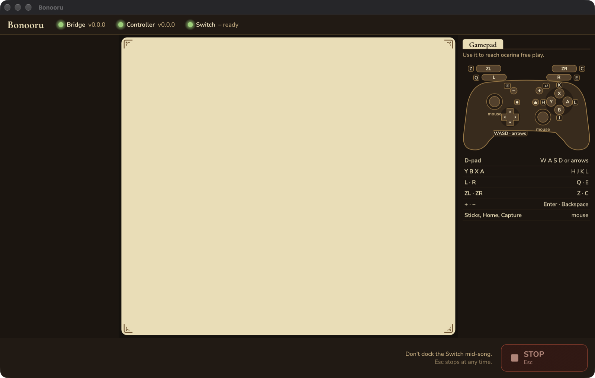

Until now, everything in Bonooru happened in a terminal. Now it has a window: it finds the bridge by itself, shows the state of all three links as it changes, and has a gamepad on the screen that I clicked to walk Link to a quiet spot and play five notes on the ocarina. The hard part wasn't drawing the window. It was making sure a button can't stay held on my console when the window disappears.

[Bonooru](https://github.com/basteez/bonooru) is my side project to play arbitrary melodies on the ocarina in *The Legend of Zelda: Ocarina of Time* on Switch 2. It does that by pretending to be a wired controller. The chain is a desktop app on the PC, a "bridge" RP2040 board on USB, a UART link, and a "controller" RP2040 board that the Switch 2 sees as a Pro Controller. [Devlog #0](https://bstz.it/p/bonooru-devlog-0/) explains the idea, [Devlog #1](https://bstz.it/p/bonooru-devlog-1/) measures the ocarina, [Devlog #2](https://bstz.it/p/bonooru-devlog-2/) is the controller firmware, [Devlog #3](https://bstz.it/p/bonooru-devlog-3/) is the bridge and the PC streaming a melody end to end.


*The Bonooru main window after Epic 4: the status strip on top, the gamepad on the right, the STOP button at the bottom. The song panel and the note view are still empty: they arrive with Epic 5.*

## Where we were

At the end of Epic 3 the PC could stream *Ode to Joy* to the Switch 2 through two boards running my firmware. But the PC side was `ocb-dev`, a command-line tool that takes a serial port and a timeline file, and the person using it was me, reading log lines.

The goal of Epic 4 was milestone M5: **the app shows the link state and drives the Switch with the virtual gamepad.** In practice:

- a real desktop window, with the look from the UX spec;
- a background worker that finds the bridge without asking me for a port, and keeps the link alive;
- three status lights, one per link: PC ↔ bridge, bridge ↔ controller, controller ↔ Switch;
- a firmware version check that refuses to drive mismatched boards;
- a STOP button, and Esc, that always work;
- an on-screen Pro Controller, by mouse and by keyboard, good enough to reach ocarina free play.

Ten stories (4.0 to 4.9), ten PRs ([#39](https://github.com/basteez/bonooru/pull/39) to [#50](https://github.com/basteez/bonooru/pull/50)), plus the epic close ([#51](https://github.com/basteez/bonooru/pull/51)) and the retrospective ([#52](https://github.com/basteez/bonooru/pull/52)), from 26 to 28 November.

## The spike pays off

Before writing any of the real app I had an agent build a throwaway Rust + egui spike, back in November, to decide between Rust and Python ([Devlog #0](https://bstz.it/p/bonooru-devlog-0/) has the numbers: 10.9 MB binary, ~115 ms cold start, 0.2 % idle CPU). Epic 4 is where that spike paid off, and not in the way I expected. **Not a single line of its code was reused.** What was reused is what it found out:

- **API churn.** egui 0.37 replaced `App::update(ctx)` with `App::ui(ui)` and changed the panel API. Most examples online, and the AI's own memory, show the old one. The spike's advice, "read the crate source in `~/.cargo/registry`, not blog posts", went straight into the dev notes. It turned out to be the most useful sentence of the epic, as you'll see below.
- **Licences.** The spike's licence scan had already flagged egui's bundled fonts (OFL-1.1 and the Ubuntu font licence) and BSL-1.0 in two Windows-only clipboard crates. When `cargo deny` stopped Story 4.1 on BSL-1.0, the decision took a minute: I allowed it rather than drop the clipboard.
- **The CI recipe.** Its list of Linux packages became the app's CI step.
- **The gamepad stub.** The spike had a 10-button gamepad with three rules that survived into the real one: key and mouse are tracked separately, key auto-repeat is ignored, and everything is released when the window loses focus. That last rule turned out to be much harder than it looked.

The workspace now has three crates that ship and three that don't:

```mermaid {caption="The app workspace after Epic 4. Only ocb-app depends on egui"}
flowchart TB
  APP["ocb-app (binary bonooru)<br/>egui/eframe window, theme, screens"] --> SVC["ocb-services<br/>serial worker, port adapter, file log<br/>no egui"]
  APP --> CORE
  SVC --> CORE["ocb-core<br/>protocol codec, sans-IO link session, port classifier<br/>no I/O, no threads, no clocks"]
  SIM["ocb-sim (dev only)<br/>fake controller, impaired channel"] -.-> CORE
  DEV["ocb-dev, ocb-probe (dev only)<br/>bench tools"] -.-> SVC
  DEV -.-> CORE
```

## A window that looks like something

Story 4.1 ([PR #40](https://github.com/basteez/bonooru/pull/40)) is the shell: a new crate, `ocb-app`, with eframe and egui pinned at exactly `=0.37.0`, a window of 1280 × 800 points (minimum 1024 × 680), dark only.

The look comes from the UX spec: warm browns, a parchment card for the notes, amber for focus and for what matters. It evokes the game without taking anything from it. Two fonts, both shipped unmodified with their licence texts: Cormorant Garamond for display text and Nunito Sans for everything else, plus egui's Hack for code.

A few things I didn't know about egui before this story:

- **Variable fonts render at their lightest weight by default.** Without setting the weight axis through `FontTweak`, every face came out ExtraLight.
- **Tab order is registration order.** So the main screen is filled in reading order with `scope_builder`, not with egui panels, to make Tab go where the eye goes.
- **No OpenType features.** egui 0.37 can't select lining or tabular figures, and Cormorant's old-style "3" at 128 pt dropped into the row below it. Cells are now sized from the glyph's real mesh bounds.
- **On Linux, Wayland wins even when you don't want it.** AccessKit's default features turn on winit's Wayland backend, and winit picks Wayland whenever `WAYLAND_DISPLAY` is set, with no fallback. Removing the variable would need `unsafe`, which the workspace forbids. So the app forces X11 at run time.

There are no pixel snapshot tests. Geometry and colours are checked on egui's `FullOutput::shapes`, which is CPU-only and the same on all three OS. One test parses the token table at the top of the design spec and checks every colour both ways, so the spec and the code can't drift. The contrast of every text colour is measured too: body text is 13.49:1 on its panel, the dimmest status colour 5.10:1.

### Screen reader: "basic", decided with numbers

Story 4.2 ([PR #41](https://github.com/basteez/bonooru/pull/41)) was a decision, not code: how far to go with screen readers ([AccessKit](https://github.com/AccessKit/accesskit), which egui uses).

- **None** would have saved 68 crates on Linux (the D-Bus stack), and left custom widgets invisible to tests too.
- **Full** would have cost an estimated 1.5 to 2 weeks, and manual passes with VoiceOver, NVDA and Orca on three OS.
- **Basic** costs about one line per widget: every custom widget reports its role and its visible label. It costs nothing at run time, because eframe only builds the tree when a screen reader asks for it.

I picked basic. The side effect I like most: the tests now find widgets the way a user does, by role and label (`get_by_role_and_label`), not by coordinates.

### Painting helpers, and a glow that was too faint

Story 4.3 ([PR #42](https://github.com/basteez/bonooru/pull/42)) built the shared painting helpers (focus ring, glow, text halo, dashed outlines, 12 painted symbols, corner brackets) and the modal dialog.

My favourite bug of the story came from my own eyes. I looked at the gallery and said the glow was "far too faint". The mockups are HTML, and CSS `box-shadow` blurs with a Gaussian of σ = blur / 2; epaint's shadow uses a linear feather. Using the CSS number as the feather width kept only 63 % of the light. The fix is a fitted constant, checked against a headless Chrome rendering of the mockup:

```rust
/// ... The w
/// minimising ∫₀^{4σ} (ramp − α·Q(d/σ))² dd with zero spread (spread is
/// `u8`, it cannot be negative) is w = 3.1 σ = 1.55 B; the largest error is
/// then 0.06 α. Before this the token was used as w directly (w = 2σ), so
/// the halo ended at d = σ, holding 63 % of the CSS halo's light and half
/// its reach (owner eye check 2026-11-27: "far too faint").
pub const CSS_BLUR_TO_FEATHER: f32 = 1.55;
```
*[`app/gui/src/ui/paint.rs`](https://github.com/basteez/bonooru/blob/d947123/app/gui/src/ui/paint.rs#L134-L138), the end of the comment*

The review found the less pretty bugs: a held Enter confirmed the *next* queued dialog before I could see it (now a dialog only answers to a key released since it opened), `f32::clamp` panicking on an inverted rectangle (it asserts even in release builds), and a dash length of 0 that hung epaint forever.

The disabled button was redone three times. A 45 % fade made the label unreadable (1.59:1). A readable label "no longer looked disabled". The final one is a neutral, opaque button with a muted label and no glow.

## The worker: the second adapter for the same session

In [Devlog #3](https://bstz.it/p/bonooru-devlog-3/) the link session went into `ocb-core` as **sans-IO** code: it never touches a port or a clock, it takes bytes and a time and gives back bytes, events and its next deadline. `ocb-dev` was the first adapter around it. Story 4.4 ([PR #44](https://github.com/basteez/bonooru/pull/44)) wrote the second: the app's serial worker, in a new crate `ocb-services` that has no egui in it.

The best number of this section: **in all of Epic 4, the link session didn't change by one line.** `git diff` over `app/core/src/link` between the start and the end of the epic is empty. The only new code in `ocb-core` is a pure port classifier.

```mermaid {caption="Threads and channels. The UI thread never blocks: it only calls try_recv"}
flowchart LR
  subgraph UI["UI thread (eframe)"]
    APP["App::logic / App::ui"]
  end
  subgraph W["bonooru-serial thread"]
    CORE["WorkerCore<br/>port + Session"]
  end
  subgraph L["bonooru-log thread"]
    LOG["bonooru.log<br/>1 MiB × 4"]
  end
  APP -- "WorkerCommand<br/>(Stop, SetState)" --> CORE
  CORE -- "events, bounded 1024" --> APP
  CORE -- "Arc&lt;LinkSnapshot&gt;, bounded 1" --> APP
  CORE -. "waker: request_repaint()" .-> APP
  CORE -- "try_send" --> LOG
  APP -- "try_send" --> LOG
  CORE == "USB CDC 460800" ==> BR["bridge"]
```

One `step()` of the worker drains the commands, scans the ports every second, opens the right one, runs one I/O pass and publishes a snapshot if anything changed. The I/O pass is the same dance as in `ocb-dev`:

```rust
match c.port.read(&mut self.buf) {
    Ok(0) => {}
    Ok(n) => {
        c.session.handle_rx(self.buf.get(..n).unwrap_or(&[]), now);
        c.last_rx_us = Some(now);
    }
    Err(PortLost(e)) => {
        self.lose(now, e);
        return;
    }
}
let now = self.clock.now_us();
if c.session.poll_timeout().is_some_and(|t| t <= now) {
    c.session.handle_timeout(now);
}
while let Some(bytes) = c.session.poll_transmit(now) {
    // ... queue the bytes, count HELLOs and frames ...
}
// A few ms at most per pass: a port that does not drain never holds
// the worker (scans, shutdown and the log stay on time).
if let Err(PortLost(e)) = c.port.flush(&self.clock) {
    lost = Some(e);
}
while let Some(ev) = c.session.poll_event() {
    events.push(ev);
}
```
*[`app/services/src/worker.rs`](https://github.com/basteez/bonooru/blob/d947123/app/services/src/worker.rs#L1103-L1158), trimmed*

Two small patterns I'm happy with.

**Latest-only snapshots.** The UI only ever needs the newest link state. The snapshot channel has capacity 1, and the worker keeps a clone of the *receiver* (crossbeam channels are multi-producer, multi-consumer) so it can throw away a snapshot the UI hasn't read yet:

```rust
fn publish(&mut self) {
    self.dirty = false;
    let snap = Arc::new(self.snapshot());
    // Capacity 1: drop the stale snapshot the UI has not read, so it
    // always gets the latest and nothing grows while the window is
    // hidden (crossbeam channels are MPMC).
    let _ = self.snap_rx.try_recv();
    let _ = self.snap_tx.try_send(snap);
    (self.waker)();
}
```
*[`app/services/src/worker.rs`](https://github.com/basteez/bonooru/blob/d947123/app/services/src/worker.rs#L1355-L1364)*

**A dead worker still wakes the UI.** egui only repaints when something asks. If the worker panics, nobody asks, and the status strip would keep showing "connected" until I moved the mouse. So `Drop` drops the snapshot sender first and then calls the waker one last time:

```rust
impl<B: Backend, C: Clock> Drop for WorkerCore<B, C> {
    fn drop(&mut self) {
        let (gone, _) = bounded(1);
        drop(std::mem::replace(&mut self.snap_tx, gone));
        (self.waker)();
    }
}
```
*[`app/services/src/worker.rs`](https://github.com/basteez/bonooru/blob/d947123/app/services/src/worker.rs#L423-L429)*

### Finding my bridge, and only my bridge

The bridge firmware from Devlog #3 has an identity: VID:PID `2E8A:000A`, product string `Bonooru Bridge`, and the flash unique ID as serial number. `2E8A:000A` is a generic Raspberry Pi ID that other boards use too (the RiiDraw firmware I started with has the same one), so the classifier sorts every port into four classes:

| Class | Rule | What the app does |
|---|---|---|
| ours | `2E8A:000A` and product exactly `Bonooru Bridge` | opens it first |
| unconfirmed | `2E8A:000A`, no usable product string (always the case on Windows, where the driver reports a "friendly name") | probes it, 2 s each in turn |
| foreign | `2E8A:000A`, another product | never opens it |
| ignored | anything else, and on macOS every `/dev/tty.*` name | never opens it |

Ports that aren't ours are never opened, so DTR is never raised on someone else's board. And reconnection follows the serial number, not the port name, because macOS renames the port after the USB socket: in the bench, replugging into another socket turned `/dev/cu.usbmodem1101` into `/dev/cu.usbmodem2101`, and the worker followed it.

Everything the worker does goes into a rotating file log (`~/Library/Logs/Bonooru/bonooru.log` on macOS), written by its own thread with no logging crate. That log turned out to be the bench instrument for the rest of the epic: every bench row below is judged by its timestamped lines.

### At the bench (macOS)

A new dev-only tool, `ocb-probe`, runs the same worker headless and prints lines a script can judge:

| Row | What | Result |
|---|---|---|
| H.28 | port list | the bridge once, `class=ours`; its `/dev/tty.*` twin ignored; the controller (a HID device, `057E:2009`) absent |
| H.29 | connect, unplug, replug | INFO 4 ms after opening; loss seen 155 ms after the last byte; after replugging into another socket, INFO 5 ms after the port was listed; scan every 1000 ms (max 1009) |
| H.31 | bridge alone, no controller | 100 HELLOs in 10 s, none dropped, no other port written |
| H.32 | the GUI app, unplug and replug | the window stayed fluid while I moved and resized it; exit 64 ms after the port closed |

The review before the bench found the best kind of bug, one in the bench tool itself: **the unplug step could pass without anyone unplugging anything.** It accepted any port loss, including a read glitch, and on replug it accepted the next connection without checking that the port had left the list first. Now it needs lost → vanished → the same serial listed again → INFO, and it has a FAIL branch named "reconnected without leaving the port list (no physical unplug)".

## Three lights

Story 4.5 ([PR #46](https://github.com/basteez/bonooru/pull/46)) is the status strip: three LEDs, one per link. Each has four states, drawn as different shapes so colour isn't the only clue: a filled dot (ok), a triangle (warning), a cross (error), a hollow ring (unknown).

The model is pure, with no egui in it (a test checks the source): `evaluate(snapshot, age, worker health) -> Leds`, a first-match decision table with 12 rows for the bridge, 9 for the controller and 5 for the Switch. It also returns *when it will next change*, so the app can ask egui to repaint exactly then and otherwise sleep.

```mermaid {caption="The Bridge ↔ Controller LED (simplified). Any state goes to unknown if the worker stalls"}
stateDiagram-v2
  [*] --> NoPort: no bridge port
  NoPort --> Opening: port open (unknown)
  Opening --> Ok: INFO → "Controller v0.0.0"
  Opening --> NotAnswering: no INFO after 500 ms (error)
  Ok --> Stale: no STATUS for > 150 ms (error)
  Stale --> Ok: fresh STATUS
  Ok --> NoLink: link_ok = 0 (error)
  NoLink --> Ok: link back
  Ok --> NoPort: port lost
  Stale --> NoPort: port lost
```

The 150 ms comes straight from Devlog #3: over 1852 STATUS frames the worst gap was 52.4 ms, so three periods of 50 ms is the staleness limit.

### The window that wasn't drawing

H.33 put the strip on the real rig: Wired Communication off and on, the controller out of the Switch and back, the bridge out of the Mac and back. All three LEDs went ok **15 ms after start**, 8 ms after the version arrived. "Switch – not ready" showed up when I turned wired communication off.

Then step 3 (controller out of the Switch) failed in a strange way. The Controller LED should go red about 150 ms after the last STATUS. It went red after **3380 ms**. The window was behind my terminal, and **macOS draws no frames for an occluded window.** Nothing repainted until the worker-stall deadline at 3 s woke it. With the window visible, the same step logged 150.264 ms.

For a status light that's a cosmetic delay. The rule became a bench checklist item ("keep the window visible"). But it planted a question that came back three stories later, with a much less cosmetic answer.

### A test that couldn't catch its own bug

The review found that the strip could freeze on "connected" forever if the worker died: the 150 ms timer fired once, and after that nothing repainted. The fix is the `Drop` above. The interesting part is that the existing test, `g16_dead_worker_unknown`, *couldn't have caught it*: it stepped the UI every 5 ms by hand, so a frame always ran. It was rewritten on a scheduler that runs frames only when egui's repaint callback asks for one, like the real event loop.

## Refusing the wrong firmware

Story 4.6 ([PR #47](https://github.com/basteez/bonooru/pull/47)) handles the day the app and the boards disagree on the protocol version. The controller then answers HELLO with a NAK, and the session stays `Incompatible`. The app shows a dialog ("Firmware update needed", with the reflash steps), turns the gamepad and the future Play button off, and says why in a line under the gamepad. Closing the dialog never lifts the block. A test proves the worker writes **zero bytes** to the controller while it's incompatible.

The review found a bug that only an immediate-mode GUI can have. egui 0.37 lays out a new window invisibly in its first pass, so the app asks for that pass to be discarded and drawn again. But eframe gives the frame's input to the first pass only, the one being thrown away. An Esc in that pass dismissed a dialog the user had never seen, and it wouldn't come back for that connection. The dialog now ignores an Esc on the frame it opens.

## STOP, in 2 milliseconds

Story 4.7 ([PR #48](https://github.com/basteez/bonooru/pull/48)) added the bottom bar and the button I care about most: STOP, 60 points tall, with "Esc" written under it. The rule from the UX spec is that **Esc is STOP, always**, in every screen, even with a dialog open. The app reads Esc first thing in every frame without consuming it, so an open dialog then consumes the same press and closes.

| H.34 (macOS) | Result |
|---|---|
| Esc | STOP ACKed 1.833 ms after the key; controller idle 8 ms after the key |
| click on STOP | ACK 1.884 ms |
| Tab to STOP, then Enter | one STOP, 2.390 ms; Enter held 2 s: exactly one more |
| five Esc, 150 ms apart | 5 requested, 5 sent, 5 ACKed (1.311 to 2.001 ms) |
| Esc held 2 s | exactly one STOP |
| bridge unplugged, Esc | `stop skipped reason=no_port`, nothing written |

The limit is 100 ms. The review fixed the race I'd least like to meet in real life: the worker read its command queue with one call and checked for a closed channel with another, and a STOP landing between the two was silently swallowed. The app had logged "queued"; the worker wrote nothing. Now it's a single `try_recv` loop.

My eye check added one thing: clicking STOP gave no visual feedback. Every button now has hover and pressed states.

## The gamepad, and the window that disappears

Story 4.8 ([PR #49](https://github.com/basteez/bonooru/pull/49)) is the on-screen Pro Controller: a silhouette with 16 buttons and 2 sticks, drawn in a 300-point panel, with the caption "Use it to reach ocarina free play." That's what it's for: walk Link somewhere quiet and take out the ocarina before a song starts.

The rules:

- A press goes out in the frame it arrives. A release is never sent earlier than 50 ms after the press, because the shortest press that always sounds is two frames, 33.3 ms (measured in [Epic 1](https://bstz.it/p/bonooru-devlog-1/)), and one more 60 Hz frame is the margin.
- The app keeps one canonical controller state and sends it (`SET_STATE`, in the controller's DIRECT mode) only when it changes.
- Sticks: full deflection at 17 points, clamped to a circle, back to centre on release.

The D-pad turns four booleans into the controller's hat value, with opposite directions cancelling:

```rust
pub fn hat(up: bool, down: bool, left: bool, right: bool) -> u8 {
    let v = i8::from(down) - i8::from(up);
    let h = i8::from(right) - i8::from(left);
    match (v, h) {
        (-1, 0) => HAT_UP,
        (-1, 1) => HAT_UP_RIGHT,
        (0, 1) => HAT_RIGHT,
        (1, 1) => HAT_DOWN_RIGHT,
        (1, 0) => HAT_DOWN,
        (1, -1) => HAT_DOWN_LEFT,
        (0, -1) => HAT_LEFT,
        (-1, -1) => HAT_UP_LEFT,
        _ => HAT_NEUTRAL,
    }
}
```
*[`app/gui/src/gamepad.rs`](https://github.com/basteez/bonooru/blob/d947123/app/gui/src/gamepad.rs#L511-L525)*

### Safety logic doesn't belong in `ui`

Here's the question H.33 had planted. A held button has to be released when the window loses focus: that was already a rule in the spike. In the first version of 4.8 the release ran in `App::ui`, on the `WindowFocused(false)` event.

The code review read eframe's source (the spike's advice, again) and found this:

```rust
if !show_ui {
    // Nothing will be shown, so we run no egui pass at all.
    // That way all ui state is left untouched, and is still there
    // when this viewport becomes visible again.
    let is_root_viewport = viewport_ui_cb.is_none();
    if is_root_viewport {
        // The app logic keeps ticking, so it can e.g. ask to be shown again:
        let egui::LogicOutput { /* ... */ } =
            integration.update_logic_only(app.as_mut(), raw_input);
        // ...
        viewport.info.events.clear(); // they should have been processed
```
*eframe 0.37.0, [`crates/eframe/src/native/wgpu_integration.rs`](https://github.com/emilk/egui/blob/0.37.0/crates/eframe/src/native/wgpu_integration.rs#L716-L732)*

For a minimised, hidden or occluded window, eframe calls `App::logic` only, **and then clears the window's events.** So: hold A with the mouse, press Cmd+H. The focus-lost event and the mouse release are thrown away with the events, `ui` never runs, and the release never happens. Meanwhile the session keeps the controller's 1-second app timeout from firing (it pings every 250 ms in DIRECT mode, on purpose, so a long note doesn't get cut). **A would stay held on the Switch for as long as the window stayed hidden.**

Nobody saw this on the bench: the review caught it first. It's exactly the H.33 symptom, a window that doesn't draw, with a button held instead of a light late.

The fix moved every piece of safety logic into `App::logic`, which runs on every pass whether the window is visible or not: blur detection (a focus-lost event, *or* the focus flag falling, *or* the viewport not visible), the 50 ms tap timer, the STOP retry and the send. Story 4.9's review later found the same hole for keys: a key-up could also be dropped in a logic-only pass, so `logic` reads key releases from the raw events too.

```rust
fn logic(&mut self, ctx: &Context, _frame: &mut eframe::Frame) {
    // ...
    // The gamepad's blur, tap timer and send also run when the window is
    // hidden: eframe then calls `logic` only and drops the window's
    // events (review 2026-11-27). Idempotent within a frame.
    if self.mode == Mode::Main {
        let (focused, visible, blur_event, key_ups) = ctx.input(|i| {
            (
                i.raw.focused,
                i.raw.viewport().visible() != Some(false),
                i.raw.events.iter()
                    .any(|e| matches!(e, egui::Event::WindowFocused(false))),
                i.raw.events.iter()
                    .filter_map(|e| match e {
                        egui::Event::Key { pressed: false, physical_key: Some(k), .. } =>
                            pad_keys::pad_key(*k),
                        _ => None,
                    })
                    .collect::<Vec<_>>(),
            )
        });
        if let Some(d) = self.pad_background_keys(focused, visible, blur_event, &key_ups) {
            self.last_pad_wake = Some(d);
            ctx.request_repaint_after(d);
        }
        self.apply_panel_surrender(ctx);
    }
}
```
*[`app/gui/src/app.rs`](https://github.com/basteez/bonooru/blob/d947123/app/gui/src/app.rs#L889-L936), reformatted*

```mermaid {caption="One eframe frame. Only logic is guaranteed to run; ui is skipped for a hidden window"}
flowchart TB
  F["frame"] --> LG["App::logic (always)<br/>drain worker (pass 0)<br/>blur / hidden → release all<br/>key-ups, tap timer, STOP retry, send"]
  LG --> V{"window visible?"}
  V -- yes --> UI["App::ui<br/>Esc = STOP, Space consumed<br/>draw strip, gamepad, bottom bar<br/>dialogs"]
  V -- no --> CLR["events cleared"]
```

There's a test for it, `g23_hidden_window_releases`, that drives a frame without calling `ui`, and a new bench step: hold A, press Cmd+H.

The other release paths each have a rule: STOP releases everything on the controller itself, so the pad sends nothing; if the link goes bad while a button is held, the app sends STOP; if the controller drops out of DIRECT mode by itself, the pad forgets what was held. And one from the review: if the worker refused the release (the console wasn't ready), nobody learned about it. A refused release now becomes a STOP.

### H.35: free play, from a mouse

On 28 November, with *Ocarina of Time* running on the Switch 2 and the Joy-Cons untouched:

| Step | What I did | What the log and the Switch said |
|---|---|---|
| 1 | click A | sent in 0 ms; controller in DIRECT 14 ms later; the console's controller screen needed two more A clicks to close (the first A registers, the second confirms) |
| 2 | drag the left stick | 249 state changes; Link walks and stops on release |
| 3 | D-pad left | the ocarina comes out |
| 4 | A, X, Y, L, R | five different notes. **M5's gamepad exit criterion, met** |
| 5 | hold A for 3.5 s | one continuous note |
| 6, 7 | STOP (Esc, then Enter) with A held | ACK 1.778, 0.759 and 1.811 ms; the note stops |
| 8 | Cmd+Tab, then Cmd+H, with A held | release sent in the same millisecond; the note stops both times |
| 10 | bridge unplugged | gamepad off 4 ms after the port loss; clicks ignored |

<video src="gamepad-to-free-play.mp4" poster="gamepad-to-free-play-poster.jpg" controls muted loop playsinline preload="metadata" style="display:block;width:100%;max-width:360px;margin:0 auto"></video>

*Filmed with my phone, no audio: the Bonooru window on my Mac at the top, the Switch 2 on the TV at the bottom. Every move Link makes comes from a mouse click or drag on the on-screen pad.*

## The keyboard, and a smaller window

Story 4.9 ([PR #50](https://github.com/basteez/bonooru/pull/50)) made the pad playable from the keyboard, without letting the keyboard press anything by accident. The pad only listens when its panel has focus (a click on it, or Tab), shows an amber ring and a "Keys active" chip, and traps Tab and the arrows so they drive the pad instead of moving focus. Two exits: Esc (which is also STOP) and a click elsewhere.

The mapping uses physical keys, so it's the same on any keyboard layout: WASD and the arrows for the D-pad, H J K L for Y B X A, Q and E for L and R, Z and C for ZL and ZR, Enter for +, Backspace for −. Repeats are ignored, chords are the union of what's held, opposite directions cancel. Below 1280 points of width, the pad becomes a compact button grid with no sticks.

H.36 met M5's keyboard exit: L K H Q E played five notes, a 3.8-second hold of L was one note despite the OS key repeat, and a chord went 0x0004 → 0x000c → 0x0004 → 0x0000. Two things surprised me at the bench, and neither was a bug:

- **Every reply I typed in the terminal took focus away from Bonooru,** so the pad released and its keys went off, exactly as designed. Each step had to start with a click on the panel.
- **The pause menu doesn't open during ocarina free play.** I pressed Enter (+) and nothing happened. Leaving free play with B first, then Enter, opened it.

## What went wrong, and what I learned

- **Safety logic must live where it always runs.** eframe skips `ui` for a hidden window and clears its events. A held button, a key-up and the worker drain were all found running only in `ui`. For Epic 6, where the app will play whole songs, the rule is written down: release and STOP logic live in `App::logic`.
- **Checks that can't fail, again.** The most common review finding, in 8 of 10 stories: a smoke test whose verdict always printed `ok`, a worker count that could never be 0, a dead-worker test that always ran a frame, a hint test that passes for any label, a queue-full test that exercised *a copy* of the send code instead of the app. The Epic 3 rule (a red proof for every bench tool) now extends to every new test.
- **Slow CI runners fail in the same few ways.** Six flaky tests in the epic, all on macOS or Windows runners, all from the same causes: tight wall-clock bounds, a time reference taken after the action, waiting for the state but not for the log line, and egui_kittest's default of 4 steps. Those rules now go in every story.
- **The Windows and Linux benches are debt.** Every bench row of the epic passed on macOS; the Windows and Linux runs wait in [issue #43](https://github.com/basteez/bonooru/issues/43), because I don't own either machine. M4 and M5 stay marked TODO in the roadmap until they pass. The next experiment is a Linux VM on the Mac with the bridge passed through over USB.
- **One open bug.** If I restart the app while the previous process is still closing the port, the new one hangs in `open()` on macOS ([issue #45](https://github.com/basteez/bonooru/issues/45)). The likely cause is the Darwin tty close waiting for output to drain while the bridge stops taking bytes. For now it's a bench rule: never restart while one is running.
- **The benches were the best test of all.** H.33 found the occluded window, H.36 found the free-play pause menu and the terminal stealing focus. None of that shows up in a unit test.

```mermaid {caption="Code review findings per story in Epic 4 (about 146 in total, almost all fixed before the bench)"}
xychart-beta
  title "Review findings per story"
  x-axis ["4.0", "4.1", "4.2", "4.3", "4.4", "4.5", "4.6", "4.7", "4.8", "4.9"]
  y-axis "findings" 0 --> 20
  bar [10, 14, 10, 16, 17, 19, 16, 14, 15, 15]
```

## How it's made

I plan and build Bonooru with the [BMad Method](https://github.com/bmad-code-org/BMAD-METHOD) and AI agents (Claude). Each story gets a file with its acceptance criteria, a table that says which tool and which log field will measure each number, and every open decision recorded; an agent implements it, three fresh-context reviewers attack it in parallel, and the findings are fixed or recorded. This epic, that was about 146 findings over 10 stories. Before every bench, the bench tools and runbooks are reviewed and dry-run against the simulated controller. What needs eyes and hands is mine: I looked at every screen and asked for changes, unplugged and replugged, and walked Link around with a mouse; the agent wrote the code and the tools and recorded the numbers as the log printed them.

Epic 4 is 10 story PRs, plus the epic close and the retrospective. At the end, the repo has 44 firmware host tests (ctest, under AddressSanitizer and UndefinedBehaviorSanitizer) and **446 Rust tests** (up from 105), across `ocb-core`, `ocb-services`, `ocb-app`, `ocb-sim` and the tools, green on Ubuntu, Windows and macOS. Story 4.0 ([PR #39](https://github.com/basteez/bonooru/pull/39)) also closed two leftovers from Epic 3: the five firmware purity gates now share one rule file, and the controller's debug STATUS counts the reply queue overflows. The bench numbers live in [`docs/test-plan.md`](https://github.com/basteez/bonooru/blob/d947123/docs/test-plan.md).

## Next up

The app can drive the Switch now, but it has nothing to play. Next epic, it learns to read music: open a song, squeeze it into the ocarina's range, work out the fingering of every note, and play it back on the PC before anything gets near the console.

Four epics in, Bonooru finally has a face, and it lets go of the buttons even when you can't see it.

---

*This is an unofficial fan project for personal, offline fun. It is not affiliated with, endorsed or sponsored by Nintendo. The Legend of Zelda and Nintendo Switch are trademarks of Nintendo. No game code, assets or console modifications are involved.*
